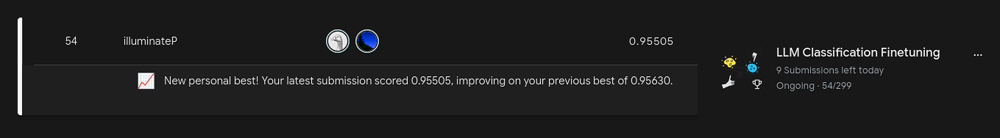
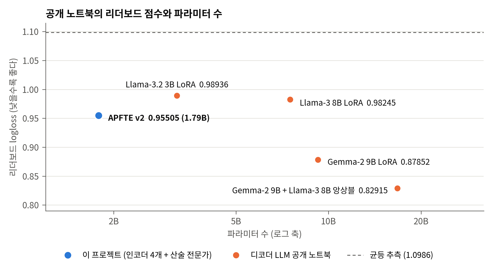
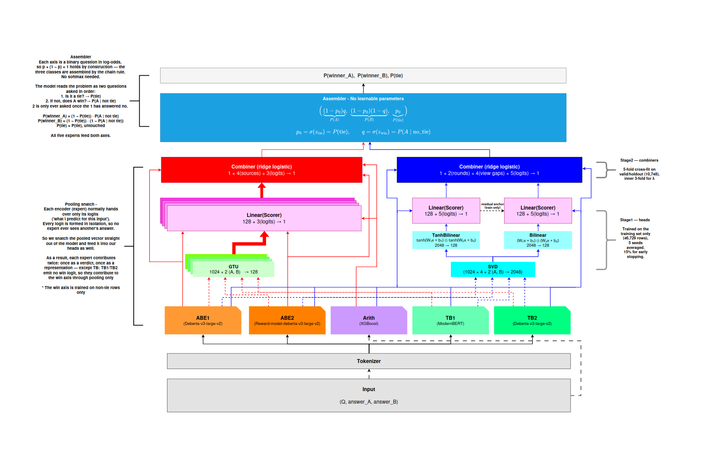
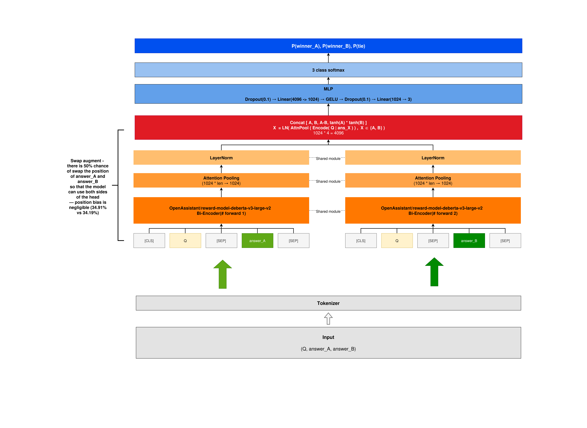
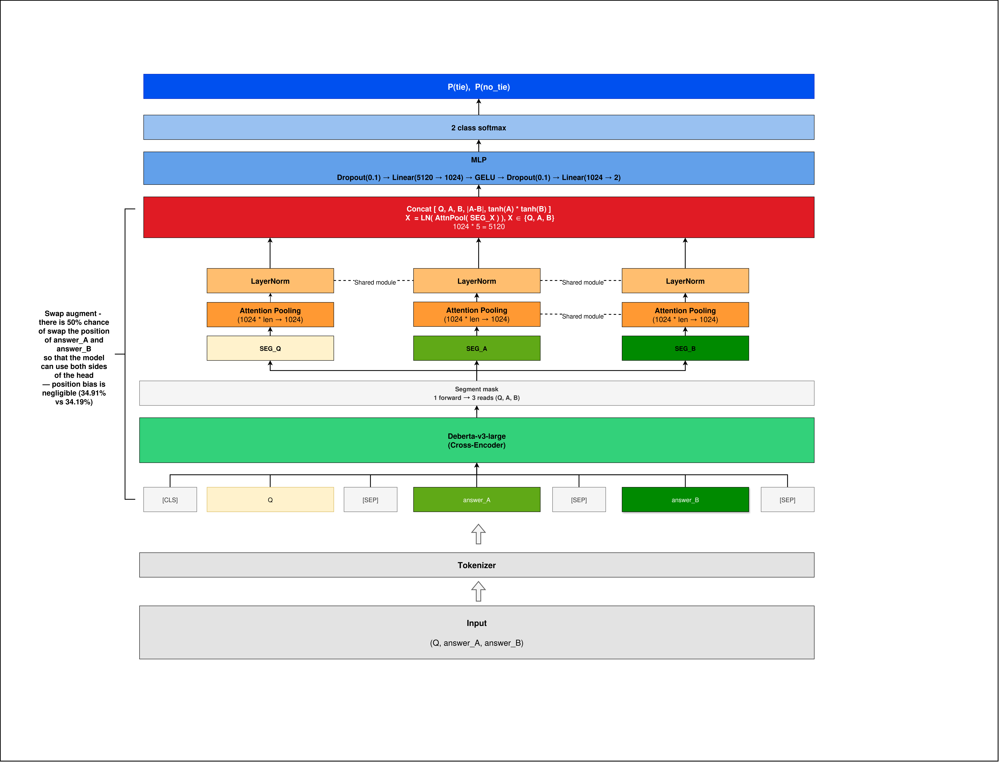
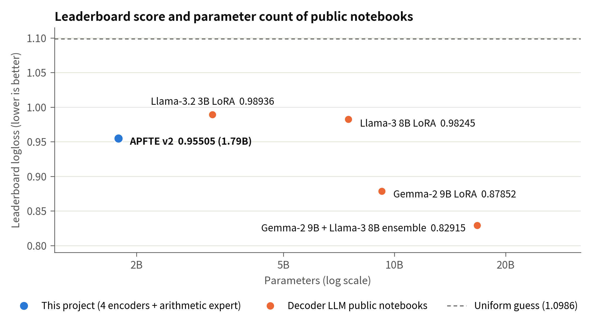

# APFTE: 인코더로 구현한 에이전틱 시스템


**언어 / Language: 한국어 (아래) · [English](#english)**




> 제출본: [A Perfectly Fine-Tuned Encoder v2](https://www.kaggle.com/code/illuminatep/a-perfectly-fine-tuned-encoder-v2)<br>
> 리더보드 logloss 0.95505 · 54위 · 공개 노트북 중 인코더 모델 1위 (2026-10-29 22:00 KST 기준)


*그림 1. 공개 노트북의 리더보드 점수와 파라미터 수(2026-10-29 기준). 왼쪽 아래로 갈수록 파라미터가 적고 logloss가 낮다.*

> 사전지식과 헤드가 서로 다른 인코더 넷이 판단과 근거를, 산술 모델 하나가 판단을 내고, 통합 헤드가 이를 '무승부인가'와 '누가 이기는가'의 두 질문으로 나눠 합치는 LLM 응답 선호 예측기를 만들었다. 이 시스템은 파라미터가 Llama-3 8B 솔루션의 4분의 1이 안 되는데도 Kaggle 리더보드에서 그 솔루션(0.98245)보다 낮은 logloss 0.95505를 기록했고, 공개 노트북 가운데 인코더 기반으로는 가장 높은 순위에 올랐다.

---

## 소개

Chatbot Arena는 같은 질문에 익명의 두 LLM이 내놓은 응답을 나란히 보여 주고, 사용자가 더 나은 쪽이나 무승부에 투표하게 하는 플랫폼이다. Kaggle의 LLM Classification Finetuning 대회는 이 투표 57,477건을 학습 데이터로 주고, 새 대화마다 A 승 · B 승 · 무승부의 세 확률을 내게 해 logloss로 채점한다. 이 대회의 공개 노트북 상위권은 Gemma-2 9B나 Llama-3 8B 같은 디코더 LLM을 분류 모델로 파인튜닝한 솔루션이다.

인코더는 디코더보다 파라미터가 훨씬 적어서(분류 모델 기준 DeBERTa-v3-large 0.44B, Llama-3 8B 7.50B) 하나만 파인튜닝해서는 logloss가 1.0 아래로 잘 내려가지 않는다. 세 결과에 1/3씩 찍어도 1.0986인데, 이 프로젝트에서 DeBERTa-v3-large로 학습한 bi-encoder도 학습에 쓰지 않은 holdout에서 1.00465에 그쳤다. 단일 모델은 특히 무승부를 잘 가려내지 못한다. holdout 5,748행의 30.9%가 무승부인데, 무승부인지만 따로 채점하면 가장 나은 단일 모델도 손실이 0.58305로, 무승부 비율만 알고 모든 행에 같은 확률을 내는 상수 예측(0.61828)보다 0.035 낮은 데 그친다. 두 응답을 따로 읽는 모델은 둘을 직접 맞대 보지 못하고, 함께 읽는 모델은 응답이 놓인 자리에 따라 판단이 흔들린다. 같은 행에서 두 응답의 자리만 바꿔도, 둘을 함께 읽는 DeBERTa-v3-large 모델의 무승부 로짓이 평균 0.19 움직인다.

그래서 입력을 서로 다르게 읽는 전문가 여럿이 다른 전문가의 답을 보지 않은 채 각자 판단(로짓)과 그 근거(풀링 벡터)를 내고, 통합 헤드 하나가 이를 합쳐 답을 내게 했다.

- 대회 train.csv를 전문가 학습용 stage 1(46,729행)과, 통합 헤드가 전문가들의 판단을 합치는 법을 배우는 stage 2(valid 5,000행 + holdout 5,748행)로 나눴다. 전문가가 학습에 쓴 행으로 합치는 법을 배우면, 그 행을 더 잘 외운 전문가를 더 믿게 되기 때문이다.
- 두 응답을 따로 읽는 bi-encoder 둘(ABE1 · ABE2, ABE = AB Expert)과 한 번에 읽는 cross-encoder 둘(TB1 · TB2, TB = TieBreaker)을 DeBERTa-v3-large · ModernBERT-large 계열에서 파인튜닝했다. bi-encoder는 세 결과를, cross-encoder는 무승부 여부를 판정한다. 여기에 길이 · 구조 · 유사도 같은 산술 특성 224개를 XGBoost로 판정하는 산술 전문가(Arith)를 더했다.
- 통합 헤드는 3-class 문제를 '무승부인가'(무승부축)와 '아니라면 A가 이기는가'(승부축)로 나눠 푼다. 두 응답의 자리를 바꾸면 무승부 판단은 그대로이고 승패 판단은 뒤집혀야 하므로, 헤드의 입력을 자리 교환에 그대로인 성분과 부호가 뒤집히는 성분으로 갈라 이 대칭을 구조에서 보장했다.
- 전문가 출력을 미리 뽑아 고정해 두고, 헤드의 구조와 하이퍼파라미터는 holdout 교차적합 점수(각 행을 그 행을 빼고 학습한 헤드로 매긴 점수)를 보며 격자 탐색으로 정했다.
- 통합 헤드의 신경망 부분은 시드 다섯 개로 따로 학습해 평균하고, 두 응답의 자리를 바꿨을 때 전문가의 판단이 흔들린 정도(뷰 불일치)도 무승부 판단의 신호로 쓴다.

인코더 네 개를 다 합쳐도 파라미터는 1.71B이고, 산술 전문가가 쓰는 MiniLM과 통합 헤드까지 더해도 1.79B라 Llama-3 8B를 파인튜닝한 솔루션(7.50B)의 4분의 1이 안 된다. 그런데도 리더보드 logloss는 0.95505로 그 솔루션(0.98245)보다 0.0274 낮았다. 2026-10-29 22:00 KST 기준으로 리더보드 전체 54위이고, 공개 노트북을 점수순으로 정렬하면 18위다. 그 위의 17개는 모두 Gemma-2 9B를 쓰는 디코더 솔루션이라(일부는 Llama-3 8B와 앙상블), 디코더 없이 인코더만 쓴 공개 노트북 중에서는 가장 높다.

단독으로는 logloss 1.0 근처에서 멈추던 인코더도, 문제를 한 번에 풀지 않고 두 질문으로 나눠 풀면서 판단과 근거를 함께 모으자 4배 넘게 큰 Llama-3 8B 솔루션보다 나은 점수를 냈다. 통합 헤드는 다섯 전문가가 낸 판단과 근거를 받아 다시 판단해, 가장 나은 단일 전문가의 holdout logloss 0.99664를 0.95473으로 낮췄다. 문제에 원래 있는 대칭은 학습에 맡기지 않고 구조에 넣었으므로, 헤드가 작아도 여러 전문가의 판단을 합칠 수 있었다. 헤드는 전문가의 로짓과 풀링 벡터만 받기 때문에, 이번에는 하지 않았지만 같은 틀에 다른 인코더나 디코더 LLM을 전문가로 더할 수도 있다.

이 저장소의 폴더 배치는 Kaggle 데이터셋 APFTE Bundle v2와 같다. 루트의 최종 노트북 하나로 재현할 수 있고, `bundle/`에는 전문가 학습 노트북과 산술 전문가 패키지, 분할 표가, `labs/`에는 데이터 탐색부터 헤드 구조를 정하기까지 진행한 실험 코드가 시기순으로 들어 있다. 가중치와 전문가 출력은 용량(9.4 GiB) 때문에 넣지 않았고 같은 데이터셋에서 받는다. 대회 데이터는 대회 규칙상 참가자가 아닌 사람에게 재배포할 수 없어 넣지 않았다. 대신 행 id로 된 분할 표를 남겨, Kaggle에서 받은 원본으로 같은 분할을 다시 만들 수 있게 했다.

---

## 1. 문제

Chatbot Arena[1]에서 사용자는 같은 질문에 달린 두 응답을 보고 A, B, 무승부 중 하나를 고른다. 이 대회는 그 투표를 한 행씩 주고, 질문(`prompt`)과 두 응답(`response_a`, `response_b`)만 보고 사람이 어느 쪽을 골랐을지 확률로 맞히게 한다. 정답이 사람의 선호라 비슷한 응답 쌍에도 판단이 갈리고, 특히 무승부는 사람마다 기준이 달라 맞히기 어렵다.

| 항목 | 내용 |
|---|---|
| 과제 유형 | 3-class 분류 (A 승 · B 승 · 무승부) |
| 입력 | `prompt`, `response_a`, `response_b` (JSON 리스트, 턴마다 문자열 하나) |
| 출력 | `winner_model_a`, `winner_model_b`, `winner_tie`의 세 확률 |
| 평가 지표 | multi-class logloss (낮을수록 좋다) |
| 제약 | 노트북으로만 제출하고 9시간 안에 끝나야 한다. 리더보드는 test의 55%로 매긴다 |

logloss는 정답 클래스에 준 확률의 음의 로그를 평균한 값이다. 세 클래스에 1/3씩 주면 1.0986(ln 3)이고, 라벨 비율(A 34.9% · B 34.2% · 무승부 30.9%)을 그대로 내도 1.0972라 둘은 거의 같다. 이 logloss는 두 이진 질문의 손실로 정확히 나뉜다. 무승부일 확률을 $`p`$, 무승부가 아닐 때 A가 이길 확률을 $`q`$라 하면 세 확률은 $`\bigl((1-p)q,\ (1-p)(1-q),\ p\bigr)`$이고, 총 손실은 (무승부축 logloss) + (무승부가 아닌 행의 비율) × (승부축 logloss)다. 이 README의 표는 총 손실과 함께 두 축의 손실을 따로 적는다.

---

## 2. 데이터

### 2.1 분할

| | stage 1 · train | stage 2 · valid | stage 2 · holdout |
|---|---:|---:|---:|
| 행 수 | 46,729 | 5,000 | 5,748 |
| A 승 | 34.91% | 34.90% | 34.92% |
| B 승 | 34.19% | 34.20% | 34.19% |
| 무승부 | 30.90% | 30.90% | 30.90% |

holdout은 대회 train.csv 57,477행에서 라벨 비율을 유지한 채 10%를 무작위로 떼어 냈고(seed 42), 남은 51,729행을 train 46,729행과 valid 5,000행으로 나눴다. 전문가 다섯은 모두 train으로만 학습했고, valid는 체크포인트를 고르거나 학습을 멈추는 데에만 썼다. 그래서 stage 2의 10,748행은 어느 전문가의 학습에도 쓰이지 않았다. 통합 헤드는 두 stage를 층마다 다르게 쓴다(4.3절, 4.4절).

분할은 id와 집합 이름만 담은 [`bundle/origin/split_ids.csv`](bundle/origin/split_ids.csv)로 남겼고, 최종 노트북은 이 표와 대회 train.csv로 세 집합을 다시 만든다.

### 2.2 전처리

**라벨** — 세 개의 원-핫 열을 정수 하나로 바꿨다(0 = A 승, 1 = B 승, 2 = 무승부).

**개행** — holdout을 뺀 51,729행에서 산술 특성 33개를 하나씩 재 보니([`feature.py`](labs/1.arith/feature.py)), 두 응답의 개행 수 차이가 사람의 선택을 가장 잘 갈랐다. 이 차이를 5분위 구간으로만 나눠 예측해도 라벨 비율만 내는 예측보다 logloss가 0.0280 낮아, 문단 수(0.0277)와 글자 수(0.0250)를 앞섰다. 그런데 DeBERTa 토크나이저는 개행을 지우므로, DeBERTa에서 출발한 ABE1 · ABE2 · TB2는 토크나이즈하기 전에 개행을 `[BR]` 토큰으로 바꿔 남겼다(ModernBERT에서 출발한 TB1은 개행을 그대로 읽는다).

**길이 제한** — 57,477행 중 7,539행(13.1%)은 질문과 응답이 두 턴 이상 이어진 대화다. 이런 멀티턴 대화도 질문은 질문끼리, 응답은 응답끼리 턴 순서대로 하나로 이어 붙여 한 턴짜리 대화와 똑같이 다루고, 정해진 길이를 넘으면 앞 60%와 뒤 40%만 남긴다. 자르는 일은 두 번 한다. 토크나이즈하기 전에 20,000자를 넘는 텍스트를 한 번 자르고, 토크나이즈한 뒤에는 전문가의 최대 토큰(ABE 2,048 · TB1 4,096 · TB2 3,072)을 질문과 두 응답에 나눠 준 몫에 맞춰 다시 자른다. 질문에 먼저 256토큰까지 주고, 남은 토큰을 두 응답이 반씩 나눈다. 한 응답이 짧아 다 쓰지 못한 몫은 다른 응답이, 그러고도 남으면 질문이 가져간다. bi-encoder는 두 응답을 따로 읽으므로 반씩 나누지 않고, 각 응답이 질문 몫을 뺀 나머지를 다 쓴다.

---

## 3. 전문가

### 3.1 전체 구조



*그림 2. 다섯 전문가와 통합 헤드. 아래에서 위로 전문가 → 층 1 헤드 → 층 2 결합기 → 조립 순서로 흐르고, 왼쪽의 빨간 경로가 승부축, 오른쪽의 파란 경로가 무승부축이다.*

그림 2의 아래쪽 다섯 전문가는 서로의 답을 보지 않은 채 각자 로짓을 낸다. 로짓은 softmax에 들어가기 전에 결과마다 매긴 점수라, 이 모델이 어느 결과를 얼마나 강하게 지지하는지를 담는다. 인코더는 보통 이 로짓만 헤드에 넘기지만, 이 프로젝트의 인코더 넷은 자기 분류 헤드에 들어가기 직전의 풀링 벡터(판단의 근거)도 꺼내 통합 헤드에 넘긴다. 그래서 인코더 하나가 판단으로 한 번, 근거로 한 번 기여한다. 통합 헤드는 이 판단과 근거를 축마다 따로 모아 하나의 답을 낸다. 여러 전문가가 따로 판단하고 한곳에서 합의하는 구조를 디코더 LLM 없이 만들었으므로, 이 시스템을 인코더로 구현한 에이전틱 시스템이라 할 수 있다.

| 전문가 | 구조 | 출발 모델 | 입력 · 최대 토큰 | 출력 | 헤드에 내는 것 | 파라미터 |
|---|---|---|---|---|---|---:|
| ABE1 | bi-encoder | `microsoft/deberta-v3-large` | (Q; A), (Q; B) 따로 · 2,048 | 3-class | 로짓 · 풀링 | 0.437B |
| ABE2 | bi-encoder | `OpenAssistant/reward-model-deberta-v3-large-v2` | (Q; A), (Q; B) 따로 · 2,048 | 3-class | 로짓 · 풀링 | 0.438B |
| TB1 | cross-encoder | `answerdotai/ModernBERT-large` | (Q; A; B) 한 번에 · 4,096 | 무승부 2-class | 로짓 · 풀링 | 0.396B |
| TB2 | cross-encoder | `microsoft/deberta-v3-large` | (Q; A; B) 한 번에 · 3,072 | 무승부 2-class | 로짓 · 풀링 | 0.439B |
| Arith | XGBoost 5-fold | 산술 특성 224개 (MiniLM 임베딩 포함) | (Q, A, B) | 3-class | 로짓 | 0.023B |
| **합계** | | | | | | **1.733B** |

파라미터는 각 가중치 파일에 든 텐서의 원소 수다. 인코더는 전문가 헤드를 포함하고, Arith의 0.023B는 특성을 뽑는 데 쓰는 `all-MiniLM-L6-v2`의 크기다.

ABE는 승패를, TB는 무승부를 맡는다. 같은 계열 안에서도 두 모델의 출발 모델과 구조를 달리했다. 서로 다른 사전지식과 구조에서 출발하면 한쪽이 놓친 것을 다른 쪽이 볼 수 있기 때문이다.

### 3.2 bi-encoder — ABE1 · ABE2



*그림 3. ABE2의 구조. (Q; A)와 (Q; B)를 같은 인코더에 따로 통과시켜 1,024차원 벡터 두 개를 얻고, 네 블록으로 이어 붙여 3-class 로짓을 낸다.*

그림 3의 ABE2는 `reward-model-deberta-v3-large-v2`에서 출발한 bi-encoder다. 이 출발 모델은 DeBERTa-v3-large[2]를 응답 품질을 채점하는 보상 모델로 학습한 것이라, 사람이 어떤 응답을 선호하는지 어느 정도 알고 시작한다. (Q; A)와 (Q; B)를 각각 같은 인코더에 통과시키고, attention pooling과 LayerNorm으로 1,024차원 벡터 `ea`, `eb`를 뽑는다. 이 둘을 [`ea`, `eb`, `ea−eb`, `tanh(ea)·tanh(eb)`]로 이어 붙인 4,096차원을 MLP에 넣으면 3-class 로짓이 나온다. 곱하기 전에 tanh를 씌워 비선형 항의 값을 −1과 1 사이로 묶었다. 이전 실험에서 `ea·eb`를 그대로 넣었더니 값이 폭발했기 때문이다(TB2도 같은 항을 쓴다). ABE1은 `deberta-v3-large`에서 출발하고, 헤드에 [`ea`, `eb`, `ea−eb`] 세 블록만 넣으며, LayerNorm을 풀링 직후가 아니라 헤드 입력에 건다.

추론할 때는 `ea`와 `eb`의 자리만 맞바꿔 헤드에 한 번 더 넣고, 두 결과를 평균한다(swap TTA, test-time augmentation). 모든 응답이 A 자리와 B 자리에서 한 번씩 채점되므로 자리에 따라 갈리는 성분이 상쇄되고, bi-encoder는 이때 인코더를 다시 돌리지 않아도 된다.

### 3.3 cross-encoder — TB1 · TB2



*그림 4. TB2의 구조. (Q; A; B)를 한 시퀀스로 인코딩한 뒤 질문 · A · B 구간을 따로 풀링하고, 다섯 블록으로 무승부 여부를 판정한다.*

그림 4의 TB2는 `deberta-v3-large`에서 출발한 cross-encoder다. 질문과 두 응답을 한 시퀀스로 인코딩하므로 어텐션이 두 응답의 토큰을 직접 맞댄다. 인코딩한 뒤 구간 마스크로 질문 · A · B 자리를 따로 attention pooling해 1,024차원 `eq`, `ea`, `eb`를 뽑고, [`eq`, `ea`, `eb`, `|ea−eb|`, `tanh(ea)·tanh(eb)`]를 MLP에 넣어 무승부인지 아닌지의 2-class 로짓을 낸다. TB1은 ModernBERT-large[3]에서 출발해 `[BR]` 없이 시퀀스 전체를 한 번에 풀링하고, 최대 4,096토큰을 읽는다.

cross-encoder는 자리를 바꾸면 시퀀스 자체가 달라지므로, swap TTA를 하려면 인코더를 통째로 한 번 더 돌려야 한다. TB는 승패 로짓을 내지 않으므로 승부축에는 풀링 벡터로만 기여한다.

### 3.4 산술 전문가 — Arith

Arith는 텍스트에서 뽑은 숫자만으로 판정하는 전문가다. (Q, A, B)에서 길이 · 구조 통계, 질문과의 관련성, 두 응답 사이의 유사도, MiniLM 임베딩과 BERTScore[4] 등 224개 특성을 뽑아 XGBoost[5] 5-fold로 3-class 로짓을 낸다. 트리 모델에는 답 직전의 내부 표현이 없으므로 로짓만 낸다. 팀원이 만든 [Kaggle 노트북](https://www.kaggle.com/code/leeshble/notebookdb5b5c1095?scriptVersionId=336442550)에서 출발해 특성을 더했고, 224개 특성의 정의와 자리 교환 규칙은 [`feature_catalog_ab224.csv`](bundle/models/ARITH/feature_catalog_ab224.csv)에 있다.

자리를 바꾼 판은 텍스트를 다시 읽지 않고 특성 행렬에서 바로 만든다. 차이 열은 부호를 뒤집고(55개), 비율 열은 역수를 취하고(1개), A판과 B판이 따로 있는 열은 값을 맞바꾸며(9쌍), 나머지 150개는 그대로 둔다. Arith는 다섯 fold 모델이 두 판에 낸 로짓을 모두 평균해 낸다.

### 3.5 학습 설정

네 인코더는 같은 뼈대의 학습 코드로 학습했다. 유효 배치 16, warmup 10%, weight decay 0.01로 최대 3 epoch을 돌리고, valid 점수가 다섯 번 연속 나아지지 않으면 멈춘다. 학습할 때는 행마다 50% 확률로 두 응답의 자리를 맞바꾸고, A 승과 B 승 라벨도 함께 바꿨다. 출발 모델 말고는 아래 표의 항목만 다르다.

| 항목 | ABE1 | ABE2 | TB1 | TB2 |
|---|---|---|---|---|
| Learning rate | 1e-5 | 5e-6 | 1e-5 | 5e-6 |
| 배치 × 누적 | 16 × 1 | 8 × 2 | 8 × 2 | 4 × 4 |
| 정밀도 | fp16 | bf16 | bf16 | bf16 |
| 학습 장비 | A40 | L4 | L40S | A40 |
| 고른 체크포인트 | 4380 | 3000 | 5000 | 4000 |
| 코드 | [`Train_ABE1_run.ipynb`](bundle/models/ABE1/Train_ABE1_run.ipynb) | [`Train_ABE2_run.ipynb`](bundle/models/ABE2/Train_ABE2_run.ipynb) | [`Train_TB1_run.ipynb`](bundle/models/TB1/Train_TB1_run.ipynb) | [`Train_TB2_run.ipynb`](bundle/models/TB2/Train_TB2_run.ipynb) |

Arith는 learning rate 0.03, 깊이 8의 XGBoost를 5-fold로 학습했다. fold마다 학습 행에 자리를 바꾼 판을 덧붙이고, valid에서 200 라운드 동안 나아지지 않으면 멈춘다([`meta.json`](bundle/models/ARITH/checkpoint-ab224/meta.json)).

---

## 4. 통합 헤드

### 4.1 두 축과 조립

통합 헤드는 3-class 문제를 한 번에 풀지 않는다. 무승부축은 모든 행에서 '무승부인가'를, 승부축은 무승부가 아닌 행에서 'A가 이기는가'를 따로 묻고, 각 축의 점수 $`z_{\text{tie}}`$, $`z_{\text{win}}`$을 시그모이드로 확률 $`p`$, $`q`$로 바꾼다. 마지막 조립은 1절의 식 $`\bigl((1-p)q,\ (1-p)(1-q),\ p\bigr)`$ 그대로이고 학습하는 파라미터가 없다. 이 조립은 softmax 없이도 세 확률의 합이 구조상 1이 되고, 손실이 두 축으로 정확히 나뉘므로 축마다 따로 고치고 따로 잴 수 있다.

### 4.2 짝 성분과 홀 성분

헤드에 들어오는 값은 언제나 응답 A 쪽과 B 쪽이 짝을 이룬 한 쌍이다. 풀링에서는 두 응답에서 읽은 1,024차원 벡터가(시퀀스 전체를 한 번에 풀링하는 TB1은 A를 앞에 둔 판과 B를 앞에 둔 판의 벡터가), 로짓에서는 A 승과 B 승의 로짓이 그 쌍이다. 두 응답의 자리를 바꾸면 무승부축의 답은 그대로여야 하고, 승부축의 답은 부호가 뒤집혀야 한다. 'A가 이기는가'가 'B가 이기는가'로 바뀌기 때문이다.

그래서 쌍을 먼저 $`u=(A+B)/2`$와 $`v=(A-B)/2`$로 가른다. $`u`$는 자리를 바꿔도 그대로인 짝 성분이고, $`v`$는 부호가 뒤집히는 홀 성분이다. 로짓은 3-class 전문가라면 $`t = z_{\text{tie}} - \log(e^{z_A}+e^{z_B})`$를 짝으로, $`m = z_A - z_B`$를 홀로 바꾸고, 무승부 2-class인 TB는 무승부 로짓과 무승부가 아닌 쪽 로짓의 차를 짝으로 쓴다. 그래서 짝 5열(전문가마다 하나)과 홀 3열(3-class 전문가마다 하나)이 헤드에 들어간다. 풀링의 $`(u, v)`$는 가역 선형 변환이고, 로짓의 $`(t, m)`$은 softmax가 쓰는 두 자유도를 그대로 옮긴 것이라 어느 쪽도 버리는 정보가 없다. $`(u, v)`$와 $`(u, -v)`$를 각각 헤드의 몸통에 통과시킨 뒤, 무승부축은 두 출력을 더하고 승부축은 뺀다. 그래서 각 축의 출력은 학습과 상관없이 자기 대칭을 정확히 지킨다.

### 4.3 층 1 — 근거를 점수로 바꾸는 신경망

층 1은 stage 1(46,729행)에서 학습한다. 전문가가 이미 학습한 행이라 여기서 나오는 로짓과 풀링은 in-sample이지만, 층 2가 쓸 stage 2를 건드리지 않는다. 조기 종료에는 stage 1에서 무작위로 고른 15%를 쓴다.

**무승부축** — 네 인코더의 짝 풀링(4 × 1,024)과 홀 풀링(4 × 1,024)을 각각 SVD(특이값 분해)로 1,024방향만 남기고, 성분마다 크기를 1로 맞춘다(화이트닝). 이 2,048차원을 몸통에 넣어 128차원으로 줄이고, 짝 로짓 5열을 옆에 바로 붙여 점수 하나를 낸다. 몸통은 두 라운드로 이루어진다. 첫 라운드는 $`\tanh(W_1x)\odot\tanh(W_2x)`$, 둘째 라운드는 $`(W_1x)\odot(W_2x)`$이고, 둘째 라운드는 학습 때 첫 라운드의 출력을 기준으로 두고 그 위에 남은 것을 배운다. 두 라운드의 점수 $`g_1`$, $`g_2`$가 층 2로 간다.

**승부축** — 인코더마다 게이트 몸통 $`\sigma(Gu)\odot\tanh(Vv)`$를 하나씩 둔다. 짝 성분이 게이트를 열고 닫고 홀 성분이 값을 실어 나르며, 값 가지와 출력층에 절편을 두지 않아 출력이 홀 대칭을 지킨다. 홀 로짓 3열을 옆에 붙여 인코더마다 점수 $`w`$ 하나를 내고, 네 점수가 층 2로 간다.

**층 1 · 층 2 설정** (최종 노트북 7절)

| 항목 | 값 | 항목 | 값 |
|---|---|---|---|
| 은닉 폭 | 128 | 층 1 learning rate · weight decay | 3e-4 · 1e-2 |
| 무승부축 SVD 랭크 | 짝 · 홀 각 1,024 | 층 1 조기 종료 | 최대 3,000 epoch, 200 epoch 무개선 시 |
| 층 1 시드 | 42 · 1 · 2 · 3 · 4 (열 평균) | 층 2 λ 격자 | 0, 1, 10, …, 10⁴ (끝에 닿으면 ×10씩 넓힘) |
| 층 2 fold | 바깥 5 (교차적합) · 안쪽 3 (λ 선택) | 층 2 fold 시드 | 42 |

### 4.4 층 2 — 판단을 하나로 묶는 결합기

층 2는 축마다 릿지 로지스틱 회귀 하나다. 무승부축은 [짝 로짓 5열 · 뷰 불일치 4열 · $`g_1`$, $`g_2`$]에 절편을 더해 stage 2의 10,748행 전체에서, 승부축은 [홀 로짓 3열 · 인코더별 $`w`$ 4열]을 절편 없이 무승부가 아닌 행에서 적합한다. 벌점은 두 묶음으로 나눠, 전문가 로짓 열에는 $`\lambda_L`$을, 층 1에서 나온 열과 뷰 불일치 열에는 $`\lambda_g`$를 따로 건다.

**뷰 불일치** — swap TTA는 인코더마다 정방향과 자리를 바꾼 판의 두 결과를 평균하지만, 두 판의 무승부 로짓 차이 $`d = |t_{\text{fwd}} - t_{\text{swp}}|`$도 따로 남긴다. 자리만 바꿨는데 판단이 움직이면 그 행에서 전문가가 판단을 굳히지 못했다는 뜻이기 때문이다. 자리 교환은 두 판을 맞바꿀 뿐이라 $`d`$는 짝이고, 그래서 인코더별 4열은 무승부축 결합기에만 들어간다. holdout에서 $`d`$의 평균은 TB1 0.02, ABE1 0.12, TB2 0.19, ABE2 0.21이다.

결합기는 바깥 5-fold로 교차적합한다. holdout의 각 행은 그 행을 보지 않은 결합기로 채점하고, 이 README에 적은 통합 헤드의 holdout 점수는 따로 밝히지 않으면 이 교차적합(OOF, out-of-fold) 점수다. λ는 fold마다 안쪽 3-fold로 고른다. 제출에 쓰는 결합기는 10,748행 전체로 한 번 더 적합하고, λ는 다섯 fold가 고른 값의 중앙값을 쓴다. 이 절차는 다른 모델의 출력 위에 결합기를 쌓는 스태킹[6]의 표준 방식을 따른다.

### 4.5 v1과 달라진 점

이 저장소의 결과는 v2 제출본이다. 앞선 v1 제출본과 비교해 네 가지를 바꿨다.

- ABE1을 stage 1만으로 다시 학습했다. v1의 ABE1은 valid 3,000행을 학습에 써서 층 2가 7,748행만 쓸 수 있었는데, 이 행을 되찾아 stage 2가 10,748행이 됐다.
- 층 1을 시드 다섯 개로 학습해 열을 평균한다.
- 무승부축 SVD 랭크를 512에서 1,024로 올렸다.
- 뷰 불일치 4열을 무승부축 결합기에 더했다.

그 결과 holdout 교차적합 점수는 0.95832에서 0.95473으로, 리더보드 logloss는 0.95630에서 0.95505로 낮아졌다.

### 4.6 구조를 정한 실험

헤드의 구조와 하이퍼파라미터는 실험으로 정했다. 전문가마다 로짓과 풀링 벡터를 미리 뽑아 고정해 두고, 그 위에서 결합 방식, 무승부축의 SVD 랭크와 몸통, 승부축의 게이트, 층 2의 벌점, 조립 방식, 대칭 구조를 하나씩 바꿔 가며 holdout 교차적합 점수로 격자 탐색했다. 실험 코드는 [`labs/`](labs/)에 시기순으로 남겼다.

---

## 5. 결과

### 5.1 측정 환경

| 항목 | 값 | 항목 | 값 |
|---|---|---|---|
| 제출 환경 | Kaggle 노트북 · T4 · 인터넷 끔 | 리더보드 | test의 55%, 소수 다섯째 자리 |
| 헤드 학습 · holdout 채점 | RX 9070 XT (ROCm) · Python 3.10 | holdout | 5,748행, 층 2 교차적합(OOF) |
| 전문가 출력 정밀도 | 로컬 bf16 · Kaggle fp16 | 기록 날짜 | 2026-10-29 22:00 KST |

### 5.2 리더보드

제출본의 리더보드 logloss는 0.95505이고, 2026-10-29 22:00 KST 기준 299팀 중 54위다.

| 솔루션 | 모델 | 파라미터 | 리더보드 logloss | 공개 노트북 순위 |
|---|---|---:|---:|---:|
| 공개 1위 | Gemma-2 9B + Llama-3 8B 앙상블 | 16.75B | **0.82915** | 1 |
| Gemma-2 9B | Gemma-2 9B | 9.24B | 0.83536 | 9 |
| Gemma-2 9B LoRA | Gemma-2 9B 4비트 + LoRA | 9.24B | 0.87852 | 16 |
| **APFTE v2 (이 프로젝트)** | 인코더 4 + XGBoost + 통합 헤드 | **1.79B** | 0.95505 | 18 |
| Llama-3 8B LoRA | Llama-3 8B 8비트 + LoRA | 7.50B | 0.98245 | 21 |
| Llama-3.2 3B LoRA | Llama-3.2 3B + LoRA | 3.21B | 0.98936 | 23 |

공개 노트북 순위는 Kaggle Code 탭을 점수순으로 정렬해 매겼다. 1~17위는 모두 Gemma-2 9B를 쓰고, 18위인 이 프로젝트가 공개된 인코더 솔루션 중 가장 높다. Llama-3 8B 솔루션보다 파라미터는 4.2배 적은데 logloss는 0.0274 낮고, 그보다 작은 Llama-3.2 3B 솔루션과 비교해도 크기는 절반 남짓이면서 logloss가 0.0343 낮다.

디코더의 파라미터 수는 각 솔루션이 쓴 기반 모델에서 언어 모델 헤드를 3-class 분류 헤드로 바꾼 크기이고, APFTE는 인코더 넷과 MiniLM, 통합 헤드를 모두 더한 값이다.

**파라미터 내역 — APFTE v2**

| 구성 | 파라미터 |
|---|---:|
| ABE1 (DeBERTa-v3-large · bi-encoder) | 437,169,156 |
| ABE2 (reward-model-deberta-v3-large-v2 · bi-encoder) | 438,213,636 |
| TB1 (ModernBERT-large · cross-encoder) | 395,834,371 |
| TB2 (DeBERTa-v3-large · cross-encoder) | 439,262,212 |
| MiniLM (all-MiniLM-L6-v2 · 산술 전문가의 임베더) | 22,713,216 |
| 통합 헤드 · 층 1 신경망 (시드 5개) | 10,494,990 |
| 통합 헤드 · SVD 기저와 정규화 통계 (시드 5개) | 42,076,240 |
| 통합 헤드 · 층 2 계수 | 59 |
| **합계** | **1,785,763,880** |

### 5.3 전문가 단독과 통합 헤드

**holdout logloss — 축별 (5,748행)**

| | 3-class | 무승부축 | 승부축 |
|---|---:|---:|---:|
| 상수 예측 (라벨 비율) | 1.09722 | 0.61828 | 0.69309 |
| ABE1 | 1.00465 | 0.58705 | 0.60431 |
| ABE2 | 1.00577 | 0.59422 | 0.59556 |
| TB1 | — | 0.60420 | — |
| TB2 | — | 0.59150 | — |
| Arith | 0.99664 | 0.58305 | 0.59852 |
| **통합 헤드** | **0.95473** | **0.56530** | **0.56356** |

3-class를 내는 세 전문가는 0.997~1.006에 모여 있다. 상수 예측과 견주면 무승부축에서는 다섯 전문가 모두 0.014~0.035, 승부축에서는 세 전문가가 0.089~0.098 낮을 뿐이다. 무승부축에서 가장 나은 전문가는 Arith이고 승부축에서는 ABE2라, 한 전문가가 두 축을 다 잘하지는 않는다. 통합 헤드는 두 축 모두에서 가장 나은 전문가보다 낫고, 3-class logloss는 가장 나은 전문가(Arith)보다 0.04191 낮다.

### 5.4 정리

Llama-3 8B를 파인튜닝한 솔루션(리더보드 logloss 0.98245)과 비교하면, 이 시스템은 전체 파라미터가 4분의 1도 안 되는데도(1.79B) logloss가 0.95505로 크게 낮았고, 디코더 없이 인코더만 쓴 공개 노트북 중 가장 높은 순위에 올랐다. 단독으로는 1.0 근처에 모여 있던 전문가들이 무승부축과 승부축에서 서로 다른 것을 보고 있었고, 통합 헤드가 그 차이를 합쳐 가장 나은 전문가보다 holdout logloss를 0.042 낮췄다. holdout은 전문가와 층 1의 학습에 쓰지 않았고 층 2에서도 그 행을 보지 않은 결합기로만 채점했으므로, 헤드를 고르는 데 쓴 holdout 점수 0.95473이 리더보드에서도 0.95505로 거의 그대로 나왔다.

점수는 모델을 키워서가 아니라 문제를 나눠서 얻었다. 세 결과(A 승 · B 승 · 무승부)를 한 번에 맞히지 않고 '무승부인가'와 '무승부가 아니라면 A가 이기는가'의 두 질문으로 나눈 뒤, 질문마다 다르게 읽는 전문가의 판단과 근거를 함께 모았다. 토큰을 생성하지 않고 벡터만 내는 인코더로도, 여러 전문가가 따로 판단하고 한곳에서 합의하는 에이전틱 시스템을 만들 수 있음을 보였다는 데 의의가 있다.

---

## 저장소 구조

폴더는 Kaggle 데이터셋 APFTE Bundle v2의 배치를 그대로 따르고, `labs/`의 번호는 시기순이다. 데이터셋을 `bundle/`에 풀면 빠진 가중치와 출력이 제자리에 들어가고, 노트북은 경로를 바꾸지 않고 돈다.

```
.
├── a-perfectly-fine-tuned-encoder-v2.ipynb   최종 노트북 — 분할 복원 → 전문가 출력 추출 → 통합 헤드 학습 → 제출
├── bundle/                                   Kaggle 데이터셋과 같은 배치 (가중치 · 토크나이저 · 출력은 데이터셋에서)
│   ├── origin/
│   │   ├── split_ids.csv                     대회 train.csv 57,477행의 id와 집합 이름
│   │   ├── arith_folds.csv                   산술 전문가의 행별 fold 번호
│   │   └── recovered_ids.csv                 ABE1 학습 노트북의 데이터 점검에 쓰는 valid 3,000행의 id
│   └── models/
│       ├── ABE1/Train_ABE1_run.ipynb         ABE1 학습 노트북의 실행본
│       ├── ABE2/Train_ABE2_run.ipynb         ABE2 학습 노트북의 실행본
│       ├── TB1/Train_TB1_run.ipynb           TB1 학습 노트북의 실행본
│       ├── TB2/Train_TB2_run.ipynb           TB2 학습 노트북의 실행본
│       └── ARITH/
│           ├── arith/                        산술 전문가 패키지
│           │   ├── __init__.py               load · train 진입점
│           │   ├── _base.py                  모듈이 함께 쓰는 상수와 자리 교환 규약
│           │   ├── preprocess.py             텍스트에서 특성 224개 추출
│           │   ├── train.py                  XGBoost 5-fold 학습과 체크포인트 저장
│           │   └── predict.py                fold 평균 · swap TTA 추론과 축별 지표
│           ├── checkpoint-ab224/meta.json    학습 설정 · fold별 최적 라운드 · 점수
│           └── feature_catalog_ab224.csv     특성 224개의 정의 · 의존성 · 자리 교환 규칙
└── labs/                                     데이터 탐색부터 헤드 구조를 정하기까지의 실험 코드
    ├── inspect-cleaned.ipynb                 데이터 탐색 (행 수 · 결측 · 라벨 · 텍스트 길이 · 모델별 승률 · 자리 편향)
    ├── 1.arith/                              산술 특성 분석과 산술 전문가 학습 (2026-07-15 ~ 08-09)
    │   ├── Features.ipynb                    특성 추출과 특성 카탈로그 생성
    │   ├── Train.ipynb                       부스터 3종(LightGBM · XGBoost · CatBoost) 학습과 비교
    │   ├── Ablation.ipynb                    특성 유형을 하나씩 끈 제거 실험
    │   ├── Arith_binary.py                   무승부만 맞히는 이진 산술 모델
    │   ├── audit_features.py                 특성 추출 전수 검사 (자리 교환 규칙 대조)
    │   ├── bench_arith.py                    특성 추출 비용 측정
    │   ├── feature.py                        산술 특성 33개의 라벨 정보량 비교 (개행 수 1위)
    │   ├── fit_arith.py                      XGBoost가 실제로 쓰는 특성 확정
    │   ├── lang_check.py                     질문과 응답의 언어 불일치 검증
    │   ├── logit_select.py                   전문가 로짓을 기준으로 한 특성 선별
    │   ├── rep_check.py                      반복 n-gram 특성 후보 검증
    │   └── train_arith.py                    산술 전문가 학습 · 추론 모듈 (arith 패키지의 전신)
    ├── 2.boost/                              전문가 로짓의 결합과 헤드 격자 (08-03 ~ 08-20)
    │   ├── Boost.ipynb                       전문가 로짓을 묶는 2차 부스터
    │   ├── Boost_Ens.ipynb                   ABE 체크포인트 앙상블을 넣은 2차 부스터
    │   ├── Cascade.ipynb                     무승부축 · 승부축 분해 구조 검증
    │   ├── Davidson.py                       짝 · 홀 좌표 위의 Davidson 무승부 모형
    │   ├── blend.py                          전문가 확률의 산술 혼합 대 기하 혼합
    │   ├── calib_sweep.py                    상위 헤드 조합에 사후 보정기 6종 적용
    │   ├── coords.py                         로짓의 스케일과 좌표가 결합에 주는 영향
    │   ├── deciderproof.py                   산술 특성으로 전문가별 신뢰도를 예측하는 결정자
    │   ├── fwls.py                           FWLS(특성 가중 선형 스태킹)
    │   ├── fwls_transfer.py                  stage 1에서 적합한 FWLS를 stage 2로 옮기기
    │   ├── headgrid.py                       헤드 6종 × 입력 4종 × 방식 3종 전수 격자
    │   ├── headgrid_final_v2.py              최종 후보 헤드 3종의 SVD 랭크 · 폭 격자
    │   ├── headgrid_solo.py                  선형 헤드 없이 신경 헤드만 평가
    │   ├── ledger.py                         전문가 단독 점수와 결합 점수를 같은 기준으로 비교
    │   ├── mlphead.py                        풀링 벡터 위에 자리 교환 대칭을 지키는 MLP 헤드
    │   ├── newhead.py                        stage 1에서 학습한 융합 헤드
    │   ├── nlfeat.py                         선형 판독 위에 비선형 판독을 더 얹기
    │   ├── repr5.py                          다섯 전문가 로짓 위에 풀링 표현 열 더하기
    │   ├── reprhead.py                       인코더 헤드 대신 풀링 벡터 위에 새 헤드
    │   ├── resfit.py                         잔차 앵커로 표현 판독을 stage 1에서 적합
    │   └── tie_ensemble.py                   무승부 모델 여럿의 앙상블
    ├── 3.head/                               통합 헤드의 층 1 · 층 2 · 조립 · 대칭 (08-09 ~ 08-22)
    │   ├── ablate_arith.py                   산술 특성 수를 줄일 때 헤드 점수의 손실
    │   ├── ardlab.py                         층 2의 열별 벌점(ARD)을 stage 1에서 학습해 옮기기
    │   ├── arith_insample.py                 ardlab용 in-sample 산술 로짓 재학습
    │   ├── arithlab.py                       산술 특성 벡터를 다섯째 풀링 소스로 투입
    │   ├── asmlab.py                         조립 단계의 교차축 항
    │   ├── combinelab.py                     승부축 온도를 행마다 바꾸기
    │   ├── comblab.py                        층 2 결합기의 함수족 비교
    │   ├── dest_fold.py                      산술 전문가의 fold별 로짓 5개를 따로 투입
    │   ├── dest_universe.py                  층 2를 적합할 행 범위 3안 비교
    │   ├── destnation.py                     확정 구조의 조립과 채점
    │   ├── factorial_heads.py                학습 행 · 선형 판독 열 · 라운드 수 요인설계
    │   ├── finlab.py                         층 2의 λ · 게이트 온도 · 부스터 등 5실험
    │   ├── fit_heads.py                      통합 헤드 학습 모듈 (노트북 셀에서 옮긴 자립판)
    │   ├── graphlab.py                       텍스트 구조 그래프의 유사도 신호
    │   ├── lam_ceiling.py                    λ를 holdout으로 고를 때의 상한
    │   ├── monohead.py                       분해 없는 3-class 헤드 기준선
    │   ├── nestlab.py                        승부 확신도로 무승부 확률을 바꾸는 nested logit
    │   ├── penfold.py                        층 2 벌점 구조 재검 (fold별 산술 로짓판)
    │   ├── penlab.py                         벌점을 fold마다 고르기 대 고정하기
    │   ├── probe_g.py                        층 1 출력 열이 무엇을 담는지 조사
    │   ├── readout.py                        무승부축 헤드의 라운드 · 판독 · 폭 격자
    │   ├── ridge_lab.py                      무승부축 릿지 판독 구조 4종 비교
    │   ├── synlab.py                         짝 · 홀 구조를 뗀 판 (설계를 synlab2에서 바로잡음)
    │   ├── synlab2.py                        짝 · 홀 분해 제거 실험 (같은 망 · 같은 파라미터)
    │   ├── synlab3.py                        swap TTA까지 뗀 제거 실험
    │   ├── tie_ladder.py                     무승부 결합기에 넣을 열 고르기
    │   ├── tiegrid.py                        무승부축 격자 (SVD 랭크 · 몸통 · 판독)
    │   ├── tierowlab.py                      승부 헤드 학습에 무승부 행 넣기
    │   ├── whitelab.py                       무승부축 입력의 화이트닝 비교
    │   └── winlab.py                         승부축 격자 (게이트 · 판독 · 폭)
    └── 4.v2/                                 v2 변경의 측정 (10-28)
        ├── nbhead.py                         노트북의 헤드 코드를 그대로 담은 모듈과 번들 로더
        ├── lab.py                            시드별 학습 · 채점 실험 키트
        ├── ensemble_v2.py                    시드 앙상블 두 방식 비교
        ├── levers_v2.py                      SVD 랭크 · 뷰 불일치와 그 조합
        ├── ard_v2.py                         층 2 열별 벌점(ARD) 대 두 묶음 릿지
        └── ard_levers_v2.py                  SVD 랭크 1024 · 2048 위의 ARD
```

| 경로 | 역할 |
|---|---|
| [`a-perfectly-fine-tuned-encoder-v2.ipynb`](a-perfectly-fine-tuned-encoder-v2.ipynb) | 최종 노트북. 분할 복원부터 전문가 출력 추출, 통합 헤드 학습, 제출까지 한 노트북에서 한다. 이 저장소의 핵심 |
| `bundle/models/*/Train_*_run.ipynb` | 인코더 학습 노트북의 실행본. 학습 곡선과 체크포인트별 점수가 출력에 남아 있다 |
| [`bundle/models/ARITH/arith/`](bundle/models/ARITH/arith/) | 산술 전문가 패키지. 최종 노트북이 불러 특성을 뽑고 예측한다 |
| [`bundle/origin/split_ids.csv`](bundle/origin/split_ids.csv) | 대회 train.csv 57,477행의 id와 집합 이름. 최종 노트북이 이 표로 분할을 복원한다 |
| [`labs/`](labs/) | 데이터 탐색부터 헤드 구조를 정하기까지의 실험 코드. 결과 파일은 없다 |

최종 노트북을 돌리면 전문가 출력은 `outputs/logits/`와 `outputs/pooled/`에, 통합 헤드는 `outputs/heads/deploy.npz`에, 제출 파일 `submission.csv`는 루트에 생긴다.

---

## 재현

이 프로젝트는 최종 노트북 하나로 재현된다. 노트북은 1절의 `SUBMIT` 한 줄로 두 가지 일을 한다. `False`이면 통합 헤드를 학습하고, `True`이면 학습해 둔 헤드를 복원해 제출 파일을 만든다. Kaggle에서는 [공개 노트북](https://www.kaggle.com/code/illuminatep/a-perfectly-fine-tuned-encoder-v2)을 복사하면(Copy & Edit) 대회 데이터와 번들이 입력으로 함께 붙으므로, `SUBMIT = True`로 돌리면 번들의 헤드로 바로 제출 파일이 나온다. 로컬에서 재현하려면 두 데이터를 받아 제자리에 둔 뒤 `False`로 한 번, `True`로 한 번 차례로 돌린다.

### 환경

전문가 학습은 클라우드 GPU에서, 헤드 학습과 holdout 채점은 로컬 GPU에서, 제출은 Kaggle에서 했다.

```bash
git clone https://github.com/illuminateP/A-Perfectly-Fine-Tuned-Encoder
cd A-Perfectly-Fine-Tuned-Encoder

# 통합 헤드 (RX 9070 XT, Python 3.10 · torch 2.10 ROCm · transformers 4.57.6 · xgboost 3.2.0)
pip install -r requirements.txt jupyterlab
```

torch는 넣지 않았다. 사용하는 가속기에 맞는 빌드를 [pytorch.org](https://pytorch.org/get-started/locally/) 안내에 따라 따로 설치한다.

### 1단계 — 대회 데이터와 번들 받기

| 자원 | 확보 방법 | 놓는 곳 |
|---|---|---|
| 대회 데이터 | [대회 페이지](https://www.kaggle.com/competitions/llm-classification-finetuning/data)에서 규칙에 동의한 뒤 받는다 | `hidden/` |
| 가중치 · 토크나이저 · 전문가 출력 | Kaggle 데이터셋 [APFTE Bundle v2](https://www.kaggle.com/datasets/illuminatep/apfte-bundle-v2)에서 받는다 (9.4 GiB) | `bundle/` |

```bash
kaggle competitions download llm-classification-finetuning -p hidden
unzip hidden/llm-classification-finetuning.zip -d hidden        # train.csv · test.csv · sample_submission.csv
kaggle datasets download illuminatep/apfte-bundle-v2 -p bundle
unzip -n bundle/apfte-bundle-v2.zip -d bundle                   # origin/ · models/ · outputs/
```

`-n`은 저장소에서 고친 파일(고정 커밋에서 모델을 받게 바꾼 학습 노트북과 산술 전문가 패키지)을 번들의 원래 파일로 덮어쓰지 않게 한다.

### 2단계 — SUBMIT = False로 통합 헤드 학습

```bash
jupyter lab a-perfectly-fine-tuned-encoder-v2.ipynb
```

1절의 `SUBMIT`을 `False`로 두고, 커널을 다시 시작해 모든 셀을 끝까지 실행한다(JupyterLab의 Kernel → Restart Kernel and Run All Cells). 노트북은 다음을 차례로 한다.

- 2절은 `split_ids.csv`와 대회 train.csv로 stage 1과 stage 2를 다시 만든다.
- 5절과 6절은 stage 1과 stage 2를 토크나이즈하고, 전문가 출력(npz)이 없을 때만 다섯 전문가로 로짓과 풀링 벡터를 뽑는다. 번들을 받았다면 출력이 이미 들어 있어 뽑는 일은 건너뛴다.
- 7절은 층 1을 시드 다섯 개로 stage 1에서 학습하고, 층 2를 stage 2에서 교차적합한 뒤 `outputs/heads/deploy.npz`에 저장한다.
- 8절은 holdout 점수를 기준값과 대조하고, 교차적합 점수를 함께 출력한다.
- 9절은 test.csv로 `submission.csv`를 만든다.

### 3단계 — SUBMIT = True로 제출 파일 만들기

1절의 `SUBMIT`을 `True`로 바꾸고 같은 방법으로 다시 돌린다. Kaggle 제출본이 이 모드다.

- 5절과 6절은 stage 2만 토크나이즈하고, stage 2의 전문가 출력이 없을 때만 뽑는다.
- 7절은 층 1과 층 2를 학습하지 않고 `outputs/heads/deploy.npz`에서 복원한다. 2단계를 돌렸다면 그때 학습한 헤드를, 아니면 번들의 헤드를 쓴다.
- 8절은 holdout 점수를 기준값과 대조해 헤드가 제대로 복원됐는지 확인한다.
- 9절은 test의 전문가 출력을 뽑아 `submission.csv`를 만든다.

### 4단계 — 결과 확인

8절이 출력하는 holdout 점수를 확인한다. 첫 줄은 holdout을 포함한 10,748행으로 적합한 제출용 결합기의 점수이고, 축별 점수가 기준값(무승부축 0.56453 · 승부축 0.56266, 합계 0.95334)과 0.0005 넘게 어긋나면 노트북이 멈춘다. 이 결합기는 holdout을 학습에 썼으므로 교차적합 점수보다 낮게 나온다. `False`로 돌렸을 때는 교차적합 점수가 한 줄 더 나오고, 5.3절의 통합 헤드 점수(0.95473)가 이 값이다.

---

## 출처 및 라이선스

- **이 저장소의 코드** — MIT ([`LICENSE`](LICENSE)).
- **대회 데이터** — Kaggle [LLM Classification Finetuning](https://www.kaggle.com/competitions/llm-classification-finetuning). 대회 규칙상 비상업 목적으로만 쓸 수 있고(CC BY-NC 4.0), `bundle/origin/`의 표에는 행 id와 분할 이름만 있다.
- **사전학습 모델과 토크나이저** — [`microsoft/deberta-v3-large`](https://huggingface.co/microsoft/deberta-v3-large/tree/64a8c8eab3e352a784c658aef62be1662607476f), [`OpenAssistant/reward-model-deberta-v3-large-v2`](https://huggingface.co/OpenAssistant/reward-model-deberta-v3-large-v2/tree/c355404efa9ad2ad069f3a197cae0523c14244fc), [`answerdotai/ModernBERT-large`](https://huggingface.co/answerdotai/ModernBERT-large/tree/45bb4654a4d5aaff24dd11d4781fa46d39bf8c13), [`sentence-transformers/all-MiniLM-L6-v2`](https://huggingface.co/sentence-transformers/all-MiniLM-L6-v2/tree/1110a243fdf4706b3f48f1d95db1a4f5529b4d41). 링크는 학습에 쓴 커밋을 가리키며, 각 모델은 해당 저장소의 라이선스를 따른다.
- **산술 전문가의 출발점** — 팀원이 작성한 [Kaggle 노트북](https://www.kaggle.com/code/leeshble/notebookdb5b5c1095?scriptVersionId=336442550). 이 저장소의 `arith` 패키지는 그 노트북에 특성을 더해 다시 짰다.
- **가중치와 전문가 출력** — Kaggle 데이터셋 [APFTE Bundle v2](https://www.kaggle.com/datasets/illuminatep/apfte-bundle-v2)로 공개되어 있다.

## 참고문헌

1. Chiang W-L, Zheng L, Sheng Y, et al. "Chatbot Arena: An Open Platform for Evaluating LLMs by Human Preference." *Proceedings of the 41st International Conference on Machine Learning (ICML)* (2024).
2. He P, Gao J, Chen W. "DeBERTaV3: Improving DeBERTa using ELECTRA-Style Pre-Training with Gradient-Disentangled Embedding Sharing." *International Conference on Learning Representations (ICLR)* (2023).
3. Warner B, Chaffin A, Clavié B, et al. "Smarter, Better, Faster, Longer: A Modern Bidirectional Encoder for Fast, Memory Efficient, and Long Context Finetuning and Inference." *arXiv preprint* arXiv:2412.13663 (2024).
4. Zhang T, Kishore V, Wu F, Weinberger KQ, Artzi Y. "BERTScore: Evaluating Text Generation with BERT." *International Conference on Learning Representations (ICLR)* (2020).
5. Chen T, Guestrin C. "XGBoost: A Scalable Tree Boosting System." *Proceedings of the 22nd ACM SIGKDD International Conference on Knowledge Discovery and Data Mining* (2016): 785-794.
6. Wolpert DH. "Stacked generalization." *Neural Networks* 5.2 (1992): 241-259.

<br/>

---
---

<a id="english"></a>

# APFTE: An agentic system, implemented with encoders

**Language: [한국어 (top)](#apfte-인코더로-구현한-에이전틱-시스템) · English (below)**


> Submission: [A Perfectly Fine-Tuned Encoder v2](https://www.kaggle.com/code/illuminatep/a-perfectly-fine-tuned-encoder-v2)<br>
> Leaderboard logloss 0.95505 · rank 54 · first among encoder models in the public notebooks (as of 2026-10-29 22:00 KST)


*Figure 1. Leaderboard score and parameter count of public notebooks (as of 2026-10-29). Points further down and to the left use fewer parameters and reach a lower logloss.*

> We built a predictor of human preference between LLM responses in which four encoders with different prior knowledge and heads submit verdicts and evidence, one arithmetic model submits a verdict, and a unified head combines them by splitting the task into two questions: is it a tie, and who wins. With less than a quarter of the parameters of the Llama-3 8B solution, the system reached a Kaggle leaderboard logloss of 0.95505, below that solution's 0.98245, and ranks highest among the public notebooks built on encoders.

## Introduction

Chatbot Arena is a platform that shows the responses of two anonymous LLMs to the same question side by side and lets users vote for the better one or for a tie. Kaggle's LLM Classification Finetuning competition hands out 57,477 of these votes as training data and asks for three probabilities on each new conversation (A wins, B wins, tie), scored by logloss. The top public notebooks in this competition are solutions that fine-tune decoder LLMs such as Gemma-2 9B or Llama-3 8B as classifiers.

Encoders have far fewer parameters than decoders (as classifiers, DeBERTa-v3-large has 0.44B and Llama-3 8B 7.50B), so a single fine-tuned encoder rarely gets its logloss below 1.0. Guessing 1/3 for every outcome already scores 1.0986, and the DeBERTa-v3-large bi-encoder trained in this project reached only 1.00465 on a holdout it never trained on. A single model struggles most with ties. Of the 5,748 holdout rows, 30.9% are ties, and when the tie question is scored on its own, even the best single model reaches a loss of 0.58305 — only 0.035 below a constant prediction that knows nothing but the tie rate and gives every row the same probability (0.61828). A model that reads the two responses separately cannot set them against each other, and a model that reads them together wavers with the slot each response sits in: swapping the two responses on the same row moves the tie logit of the DeBERTa-v3-large model that reads them together by 0.19 on average.

So we had several experts that read the input in different ways each submit a verdict (logits) and its evidence (a pooled vector) without seeing any other expert's answer, and had a single unified head combine them into one answer.

- We split the competition's train.csv into stage 1 (46,729 rows) for training the experts and stage 2 (5,000 valid + 5,748 holdout rows), on which the unified head learns how to combine the experts' verdicts. If the head learned to combine on rows the experts had trained on, it would come to trust whichever expert memorized those rows best.
- We fine-tuned two bi-encoders that read the responses separately (ABE1 · ABE2, ABE = AB Expert) and two cross-encoders that read them together (TB1 · TB2, TB = TieBreaker) from the DeBERTa-v3-large and ModernBERT-large families. The bi-encoders judge all three outcomes; the cross-encoders judge only whether it is a tie. An arithmetic expert (Arith) that judges 224 arithmetic features such as length, structure and similarity with XGBoost joins them.
- The unified head splits the 3-class task into "is it a tie?" (the tie axis) and "if not, does A win?" (the win axis). Swapping the two responses must leave the tie verdict unchanged and flip the win verdict, so the head's input is split into a part that stays put under the swap and a part that changes sign, and the symmetry is guaranteed by construction.
- We extracted and froze the experts' outputs, then settled the head's structure and hyperparameters by grid search on the holdout cross-fit score (each row scored by a head trained without that row).
- The unified head averages its neural part over five seeds and also uses, as a tie signal, how far each expert's verdict moves when the two responses swap places (view disagreement).

The four encoders add up to 1.71B parameters, and even with the MiniLM inside the arithmetic expert and the unified head the total is 1.79B — under a quarter of the solution that fine-tunes Llama-3 8B (7.50B). Even so, the leaderboard logloss of 0.95505 is 0.0274 below that solution's 0.98245. As of 2026-10-29 22:00 KST the project ranks 54th on the leaderboard and 18th when the public notebooks are sorted by score. All 17 above it are decoder solutions built on Gemma-2 9B (some in an ensemble with Llama-3 8B), so it is the highest among the public notebooks that use encoders without a decoder.

Encoders that stall near a logloss of 1.0 on their own beat the Llama-3 8B solution, more than four times their size, once the task was split into two questions and their verdicts and evidence were gathered together. The unified head takes the five experts' verdicts and evidence and judges again, bringing the best single expert's holdout logloss of 0.99664 down to 0.95473. Because the symmetry the task already has was built into the structure instead of being left to training, a small head was enough to combine many experts. The head takes only the experts' logits and pooled vectors, so other encoders or decoder LLMs could join the same frame as experts, although this project did not try it.

This repository has the same folder layout as the Kaggle dataset APFTE Bundle v2. The final notebook at the root reproduces the result on its own; `bundle/` holds the expert training notebooks, the arithmetic-expert package and the split tables, and `labs/` holds the experiment code from data exploration to settling the head's structure, in chronological order. The weights and expert outputs are left out for size (9.4 GiB) and come from the same dataset. The competition data is left out because the competition rules forbid redistributing it to anyone who has not joined the competition; a split table of row ids is kept instead, so the same split can be rebuilt from the original downloaded from Kaggle.

## 1. Problem

On Chatbot Arena [1] a user sees two responses to the same question and picks A, B or a tie. The competition gives one vote per row and asks, from the question (`prompt`) and the two responses (`response_a`, `response_b`) alone, for the probability of each choice. The answer is a human preference, so judgments split even on similar response pairs, and ties are especially hard to call because people draw the line in different places.

| Item | Detail |
|---|---|
| Task type | 3-class classification (A wins · B wins · tie) |
| Input | `prompt`, `response_a`, `response_b` (JSON lists, one string per turn) |
| Output | Three probabilities: `winner_model_a`, `winner_model_b`, `winner_tie` |
| Metric | Multi-class logloss (lower is better) |
| Constraints | Notebook submissions only, finishing within 9 hours. The leaderboard is scored on 55% of the test set |

Logloss is the mean negative log of the probability given to the correct class. Giving 1/3 to every class scores 1.0986 (ln 3), and predicting the label rates (A 34.9% · B 34.2% · tie 30.9%) scores 1.0972, almost the same. This logloss splits exactly into the losses of two binary questions. With $`p`$ the probability of a tie and $`q`$ the probability that A wins given no tie, the three probabilities are $`\bigl((1-p)q,\ (1-p)(1-q),\ p\bigr)`$, and the total loss equals (tie-axis logloss) + (share of non-tie rows) × (win-axis logloss). The tables in this README report the losses of both axes alongside the total.

## 2. Data

### 2.1 Splits

| | stage 1 · train | stage 2 · valid | stage 2 · holdout |
|---|---:|---:|---:|
| Rows | 46,729 | 5,000 | 5,748 |
| A wins | 34.91% | 34.90% | 34.92% |
| B wins | 34.19% | 34.20% | 34.19% |
| Tie | 30.90% | 30.90% | 30.90% |

The holdout is a random 10% of the 57,477 rows of the competition's train.csv, drawn with the label rates preserved (seed 42), and the remaining 51,729 rows were split into 46,729 train and 5,000 valid rows. All five experts trained on train alone and used valid only to pick checkpoints or stop training, so none of the 10,748 stage-2 rows took part in any expert's training. The unified head uses the two stages differently in each layer (Sections 4.3 and 4.4).

The split is kept as [`bundle/origin/split_ids.csv`](bundle/origin/split_ids.csv), which holds only ids and set names, and the final notebook rebuilds the three sets from this table and the competition's train.csv.

### 2.2 Preprocessing

**Labels** — The three one-hot columns become one integer (0 = A wins, 1 = B wins, 2 = tie).

**Line breaks** — Measuring 33 arithmetic features one at a time on the 51,729 rows outside the holdout ([`feature.py`](labs/1.arith/feature.py)) showed that the difference in line-break counts between the two responses separates human choices best. Predicting from that difference cut into quintile buckets alone lowers logloss by 0.0280 against predicting the label rates, ahead of the paragraph count (0.0277) and the character count (0.0250). The DeBERTa tokenizer drops line breaks, however, so ABE1 · ABE2 · TB2, which start from DeBERTa, replace them with a `[BR]` token before tokenizing (TB1, which starts from ModernBERT, reads line breaks as they are).

**Length limits** — Of the 57,477 rows, 7,539 (13.1%) are conversations in which the question and the responses run to two or more turns. Such multi-turn conversations are handled exactly like single-turn ones: the question turns are joined in order into one question and the response turns into one response, and text over the limit keeps its first 60% and last 40%. Cutting happens twice. Before tokenizing, any text over 20,000 characters is cut once; after tokenizing, the expert's maximum tokens (ABE 2,048 · TB1 4,096 · TB2 3,072) are divided into shares for the question and the two responses, and each part is cut again to its share. The question gets up to 256 tokens first, and the two responses split the remaining tokens evenly. A share that a short response leaves unused goes to the other response, and whatever is still left returns to the question. Bi-encoders read the two responses separately, so they do not split evenly: each response may use everything except the question's share.

## 3. Experts

### 3.1 Overall structure


*Figure 2. The five experts and the unified head. Data flows bottom to top from the experts through the layer-1 heads and the layer-2 combiners to the assembler; the red path on the left is the win axis and the blue path on the right is the tie axis.*

The five experts at the bottom of Figure 2 each submit logits without seeing each other's answers. Logits are the scores a model gives each outcome before the softmax, so they carry how strongly the model backs each outcome. An encoder normally hands only these logits to a head; the four encoders in this project also pull out the pooled vector just before their own classification head (the evidence behind the verdict) and pass it to the unified head. Each encoder therefore contributes twice, once as a verdict and once as evidence. The unified head gathers the verdicts and the evidence separately for each axis and returns a single answer. Since this structure, in which several experts judge on their own and reach agreement in one place, was built without a decoder LLM, the system can be called an agentic system implemented with encoders.

| Expert | Structure | Starting model | Input · max tokens | Output | Submits | Parameters |
|---|---|---|---|---|---|---:|
| ABE1 | bi-encoder | `microsoft/deberta-v3-large` | (Q; A), (Q; B) separately · 2,048 | 3-class | logits · pooling | 0.437B |
| ABE2 | bi-encoder | `OpenAssistant/reward-model-deberta-v3-large-v2` | (Q; A), (Q; B) separately · 2,048 | 3-class | logits · pooling | 0.438B |
| TB1 | cross-encoder | `answerdotai/ModernBERT-large` | (Q; A; B) in one pass · 4,096 | tie 2-class | logits · pooling | 0.396B |
| TB2 | cross-encoder | `microsoft/deberta-v3-large` | (Q; A; B) in one pass · 3,072 | tie 2-class | logits · pooling | 0.439B |
| Arith | XGBoost 5-fold | 224 arithmetic features (incl. MiniLM embeddings) | (Q, A, B) | 3-class | logits | 0.023B |
| **Total** | | | | | | **1.733B** |

Parameters are the element counts of the tensors in each weight file. The encoder counts include each expert's own head, and Arith's 0.023B is the size of the `all-MiniLM-L6-v2` used to extract features.

ABE handles who wins and TB handles ties. Within each family the two models start from different models and differ in structure, because when two models start from different prior knowledge and structures, one can catch what the other misses.

### 3.2 Bi-encoders — ABE1 · ABE2


*Figure 3. The structure of ABE2. (Q; A) and (Q; B) pass through the same encoder separately to give two 1,024-dimensional vectors, which are concatenated into four blocks to produce 3-class logits.*

ABE2 in Figure 3 is a bi-encoder that starts from `reward-model-deberta-v3-large-v2`. This starting model is DeBERTa-v3-large [2] trained as a reward model that scores response quality, so it begins with some sense of which responses people prefer. (Q; A) and (Q; B) each pass through the same encoder, and attention pooling and LayerNorm draw the 1,024-dimensional vectors `ea` and `eb`. Concatenated into [`ea`, `eb`, `ea−eb`, `tanh(ea)·tanh(eb)`], they give 4,096 dimensions, which an MLP turns into 3-class logits. The tanh before the product keeps the nonlinear term between −1 and 1, because feeding the raw product `ea·eb` made the values explode in an earlier experiment (TB2 uses the same term). ABE1 starts from `deberta-v3-large`, feeds only the three blocks [`ea`, `eb`, `ea−eb`] to its head, and applies LayerNorm at the head input rather than right after pooling.

At inference, only `ea` and `eb` swap places for a second pass through the head, and the two results are averaged (swap TTA, test-time augmentation). Every response is scored once in the A slot and once in the B slot, so the part that depends on the slot cancels out, and a bi-encoder does not have to run the encoder again for it.

### 3.3 Cross-encoders — TB1 · TB2


*Figure 4. The structure of TB2. (Q; A; B) is encoded as one sequence, the question, A and B spans are pooled separately, and five blocks decide whether it is a tie.*

TB2 in Figure 4 is a cross-encoder that starts from `deberta-v3-large`. It encodes the question and both responses as one sequence, so attention sets the tokens of the two responses directly against each other. After encoding, span masks pool the question, A and B positions separately into the 1,024-dimensional `eq`, `ea` and `eb`, and an MLP takes [`eq`, `ea`, `eb`, `|ea−eb|`, `tanh(ea)·tanh(eb)`] to give 2-class logits for tie or no tie. TB1 starts from ModernBERT-large [3], pools the whole sequence at once without `[BR]`, and reads up to 4,096 tokens.

For a cross-encoder, swapping the slots changes the sequence itself, so swap TTA means running the whole encoder a second time. TB emits no win logits, so it contributes to the win axis only through its pooled vectors.

### 3.4 Arithmetic expert — Arith

Arith is an expert that judges from numbers drawn from the text alone. It draws 224 features from (Q, A, B) — length and structure statistics, relevance to the question, similarity between the two responses, MiniLM embeddings and BERTScore [4], among others — and an XGBoost [5] 5-fold model turns them into 3-class logits. A tree model has no internal representation right before its answer, so Arith submits logits only. It started from a [Kaggle notebook](https://www.kaggle.com/code/leeshble/notebookdb5b5c1095?scriptVersionId=336442550) by a teammate and added features; the definitions and swap rules of the 224 features are in [`feature_catalog_ab224.csv`](bundle/models/ARITH/feature_catalog_ab224.csv).

The swapped version is built straight from the feature matrix without reading the text again: difference columns flip sign (55), the ratio column is inverted (1), columns that come in an A and a B version exchange values (9 pairs), and the remaining 150 stay as they are. Arith submits the average of the logits that its five fold models give on both versions.

### 3.5 Training setup

The four encoders were trained with the same training-code skeleton: effective batch 16, 10% warmup and weight decay 0.01 for up to 3 epochs, stopping once the valid score fails to improve five times in a row. During training, each row had its two responses swapped with 50% probability, with the A-wins and B-wins labels swapped along with them. Apart from the starting model, only the items in the table below differ.

| Item | ABE1 | ABE2 | TB1 | TB2 |
|---|---|---|---|---|
| Learning rate | 1e-5 | 5e-6 | 1e-5 | 5e-6 |
| Batch × accumulation | 16 × 1 | 8 × 2 | 8 × 2 | 4 × 4 |
| Precision | fp16 | bf16 | bf16 | bf16 |
| Training hardware | A40 | L4 | L40S | A40 |
| Chosen checkpoint | 4380 | 3000 | 5000 | 4000 |
| Code | [`Train_ABE1_run.ipynb`](bundle/models/ABE1/Train_ABE1_run.ipynb) | [`Train_ABE2_run.ipynb`](bundle/models/ABE2/Train_ABE2_run.ipynb) | [`Train_TB1_run.ipynb`](bundle/models/TB1/Train_TB1_run.ipynb) | [`Train_TB2_run.ipynb`](bundle/models/TB2/Train_TB2_run.ipynb) |

Arith trains a depth-8 XGBoost with learning rate 0.03 over 5 folds. Each fold appends the swapped version of its training rows and stops once valid fails to improve for 200 rounds ([`meta.json`](bundle/models/ARITH/checkpoint-ab224/meta.json)).

## 4. Unified head

### 4.1 Two axes and assembly

The unified head does not solve the 3-class task in one go. The tie axis asks "is it a tie?" on every row and the win axis asks "does A win?" on the non-tie rows, and a sigmoid turns each axis's score $`z_{\text{tie}}`$, $`z_{\text{win}}`$ into the probabilities $`p`$ and $`q`$. The final assembly is the formula from Section 1, $`\bigl((1-p)q,\ (1-p)(1-q),\ p\bigr)`$, with no learned parameters. With this assembly the three probabilities sum to 1 by construction without a softmax, and since the loss splits exactly into the two axes, each axis can be improved and measured on its own.

### 4.2 Even and odd parts

Every value that reaches the head comes as a pair, one side for response A and one for response B. For the pooling, the pair is the two 1,024-dimensional vectors read from the two responses (for TB1, which pools the whole sequence at once, the vectors of the version with A first and the version with B first); for the logits, it is the A-wins and B-wins logits. Swapping the two responses must leave the tie axis's answer unchanged and flip the sign of the win axis's answer, because "does A win?" becomes "does B win?".

So the pair is first split into $`u=(A+B)/2`$ and $`v=(A-B)/2`$. $`u`$ is the even part, which stays put when the slots swap, and $`v`$ is the odd part, which changes sign. A 3-class expert's logits become $`t = z_{\text{tie}} - \log(e^{z_A}+e^{z_B})`$ as the even part and $`m = z_A - z_B`$ as the odd part, and TB, a tie 2-class model, uses the difference between its tie and no-tie logits as the even part. That gives the head 5 even columns (one per expert) and 3 odd columns (one per 3-class expert). The pooled $`(u, v)`$ is an invertible linear transform, and the logits' $`(t, m)`$ carries exactly the two degrees of freedom that a softmax uses, so neither loses information. $`(u, v)`$ and $`(u, -v)`$ each pass through the head's body, and the tie axis adds the two outputs while the win axis subtracts them. Each axis's output therefore keeps its own symmetry exactly, regardless of training.

### 4.3 Layer 1 — a network that turns evidence into scores

Layer 1 trains on stage 1 (46,729 rows). The experts have already trained on these rows, so the logits and pooled vectors here are in-sample, but layer 1 leaves stage 2 untouched for layer 2. Early stopping uses a random 15% of stage 1.

**Tie axis** — The even pooling (4 × 1,024) and the odd pooling (4 × 1,024) of the four encoders are each reduced by SVD (singular value decomposition) to 1,024 directions, and every component is scaled to unit size (whitening). The body takes these 2,048 dimensions down to 128, and the 5 even logit columns are attached right beside it to produce one score. The body has two rounds: the first is $`\tanh(W_1x)\odot\tanh(W_2x)`$ and the second is $`(W_1x)\odot(W_2x)`$, and during training the second round takes the first round's output as its baseline and learns what is left on top of it. The two rounds' scores $`g_1`$ and $`g_2`$ go to layer 2.

**Win axis** — Each encoder gets its own gated body $`\sigma(Gu)\odot\tanh(Vv)`$. The even part opens and closes the gate and the odd part carries the value, and with no bias in the value branch or the output layer, the output keeps its odd symmetry. The 3 odd logit columns are attached beside it to produce one score $`w`$ per encoder, and the four scores go to layer 2.

**Layer 1 · layer 2 settings** (Section 7 of the final notebook)

| Item | Value | Item | Value |
|---|---|---|---|
| Hidden width | 128 | Layer-1 learning rate · weight decay | 3e-4 · 1e-2 |
| Tie-axis SVD rank | 1,024 each for even · odd | Layer-1 early stopping | up to 3,000 epochs, stop after 200 epochs without improvement |
| Layer-1 seeds | 42 · 1 · 2 · 3 · 4 (columns averaged) | Layer-2 λ grid | 0, 1, 10, …, 10⁴ (widened ×10 when the edge is hit) |
| Layer-2 folds | 5 outer (cross-fit) · 3 inner (λ choice) | Layer-2 fold seed | 42 |

### 4.4 Layer 2 — a combiner that ties the verdicts together

Layer 2 is one ridge logistic regression per axis. The tie axis fits [5 even logit columns · 4 view-disagreement columns · $`g_1`$, $`g_2`$] plus an intercept on all 10,748 stage-2 rows, and the win axis fits [3 odd logit columns · 4 per-encoder $`w`$ columns] without an intercept on the non-tie rows. The penalty comes in two groups: $`\lambda_L`$ on the expert logit columns and a separate $`\lambda_g`$ on the columns from layer 1 and the view-disagreement columns.

**View disagreement** — Swap TTA averages each encoder's forward and swapped results, but the gap between the two versions' tie logits, $`d = |t_{\text{fwd}} - t_{\text{swp}}|`$, is also kept on its own. If the verdict moves when only the slots change, the expert has not settled its verdict on that row. Swapping only exchanges the two versions, so $`d`$ is even, and the four per-encoder columns therefore enter only the tie-axis combiner. On the holdout, the mean of $`d`$ is 0.02 for TB1, 0.12 for ABE1, 0.19 for TB2 and 0.21 for ABE2.

The combiners are cross-fitted over 5 outer folds. Each holdout row is scored by a combiner that never saw it, and unless stated otherwise, every holdout score of the unified head in this README is this cross-fit (OOF, out-of-fold) score. λ is chosen in each fold by 3 inner folds. The combiner used for submission is fitted once more on all 10,748 rows with the median of the λ values the five folds picked. The procedure follows the standard practice of stacking [6], which builds a combiner on top of other models' outputs.

### 4.5 Differences from v1

The results in this repository are from the v2 submission. Compared with the earlier v1 submission, four things changed.

- ABE1 was retrained on stage 1 alone. The v1 ABE1 had trained on 3,000 valid rows, which left only 7,748 rows for layer 2; recovering them grew stage 2 to 10,748 rows.
- Layer 1 is trained with five seeds and its columns are averaged.
- The tie-axis SVD rank was raised from 512 to 1,024.
- The 4 view-disagreement columns were added to the tie-axis combiner.

As a result, the holdout cross-fit score fell from 0.95832 to 0.95473 and the leaderboard logloss from 0.95630 to 0.95505.

### 4.6 Experiments that shaped the structure

The head's structure and hyperparameters were settled by experiment. With every expert's logits and pooled vectors extracted and frozen, we varied the combining method, the tie axis's SVD rank and body, the win axis's gate, layer 2's penalty, the assembly and the symmetry structure one at a time and grid-searched them on the holdout cross-fit score. The experiment code is kept in [`labs/`](labs/) in chronological order.

## 5. Results

### 5.1 Measurement setup

| Item | Value | Item | Value |
|---|---|---|---|
| Submission environment | Kaggle notebook · T4 · internet off | Leaderboard | 55% of test, five decimal places |
| Head training · holdout scoring | RX 9070 XT (ROCm) · Python 3.10 | Holdout | 5,748 rows, layer-2 cross-fit (OOF) |
| Expert output precision | local bf16 · Kaggle fp16 | Recorded | 2026-10-29 22:00 KST |

### 5.2 Leaderboard

The submission scored a leaderboard logloss of 0.95505 and ranked 54th of 299 teams as of 2026-10-29 22:00 KST.

| Solution | Model | Parameters | Leaderboard logloss | Public notebook rank |
|---|---|---:|---:|---:|
| Public #1 | Gemma-2 9B + Llama-3 8B ensemble | 16.75B | **0.82915** | 1 |
| Gemma-2 9B | Gemma-2 9B | 9.24B | 0.83536 | 9 |
| Gemma-2 9B LoRA | Gemma-2 9B 4-bit + LoRA | 9.24B | 0.87852 | 16 |
| **APFTE v2 (this project)** | 4 encoders + XGBoost + unified head | **1.79B** | 0.95505 | 18 |
| Llama-3 8B LoRA | Llama-3 8B 8-bit + LoRA | 7.50B | 0.98245 | 21 |
| Llama-3.2 3B LoRA | Llama-3.2 3B + LoRA | 3.21B | 0.98936 | 23 |

The public notebook rank comes from sorting the Kaggle Code tab by score. Ranks 1–17 all use Gemma-2 9B, and this project, at 18th, is the highest public encoder solution. It has 4.2 times fewer parameters than the Llama-3 8B solution yet a logloss 0.0274 lower, and even against the smaller Llama-3.2 3B solution it is a little over half the size with a logloss 0.0343 lower.

The decoders' parameter counts are the size of each solution's base model with its language-model head replaced by a 3-class classification head, and APFTE's count is the sum of the four encoders, MiniLM and the unified head.

**Parameter breakdown — APFTE v2**

| Component | Parameters |
|---|---:|
| ABE1 (DeBERTa-v3-large · bi-encoder) | 437,169,156 |
| ABE2 (reward-model-deberta-v3-large-v2 · bi-encoder) | 438,213,636 |
| TB1 (ModernBERT-large · cross-encoder) | 395,834,371 |
| TB2 (DeBERTa-v3-large · cross-encoder) | 439,262,212 |
| MiniLM (all-MiniLM-L6-v2 · the arithmetic expert's embedder) | 22,713,216 |
| Unified head · layer-1 networks (5 seeds) | 10,494,990 |
| Unified head · SVD bases and normalization statistics (5 seeds) | 42,076,240 |
| Unified head · layer-2 coefficients | 59 |
| **Total** | **1,785,763,880** |

### 5.3 Experts alone vs. the unified head

**Holdout logloss — by axis (5,748 rows)**

| | 3-class | Tie axis | Win axis |
|---|---:|---:|---:|
| Constant prediction (label rates) | 1.09722 | 0.61828 | 0.69309 |
| ABE1 | 1.00465 | 0.58705 | 0.60431 |
| ABE2 | 1.00577 | 0.59422 | 0.59556 |
| TB1 | — | 0.60420 | — |
| TB2 | — | 0.59150 | — |
| Arith | 0.99664 | 0.58305 | 0.59852 |
| **Unified head** | **0.95473** | **0.56530** | **0.56356** |

The three experts that give 3-class outputs cluster at 0.997–1.006. Against the constant prediction, all five experts are only 0.014–0.035 lower on the tie axis, and the three experts 0.089–0.098 lower on the win axis. The best expert on the tie axis is Arith and on the win axis ABE2, so no single expert is best at both. The unified head beats the best expert on both axes, and its 3-class logloss is 0.04191 below that of the best expert (Arith).

### 5.4 Summary

Compared with the solution that fine-tunes Llama-3 8B (leaderboard logloss 0.98245), this system has under a quarter of the total parameters (1.79B) yet a far lower logloss of 0.95505, and it ranks highest among the public notebooks that use encoders without a decoder. The experts, clustered near 1.0 on their own, were seeing different things on the tie and win axes, and the unified head combined those differences to bring the holdout logloss 0.042 below the best expert. The holdout was never used to train the experts or layer 1, and in layer 2 each of its rows was scored only by a combiner that had not seen it, so the holdout score of 0.95473 used to choose the head carried over almost unchanged to 0.95505 on the leaderboard.

The score came from splitting the problem, not from a bigger model. Instead of predicting the three outcomes (A wins · B wins · tie) at once, we split them into two questions, "is it a tie?" and "if not, does A win?", and for each question gathered the verdicts and evidence of experts that read the input differently. The result shows that encoders, which output vectors instead of generating tokens, can also form an agentic system in which several experts judge on their own and reach agreement in one place.

## Repository Structure

The folders follow the layout of the Kaggle dataset APFTE Bundle v2, and the numbers in `labs/` are chronological. Unpacking the dataset into `bundle/` puts the missing weights and outputs in place, and the notebook runs without changing any path.

```
.
├── a-perfectly-fine-tuned-encoder-v2.ipynb   final notebook — split rebuild → expert output extraction → unified head training → submission
├── bundle/                                   same layout as the Kaggle dataset (weights · tokenizers · outputs come from the dataset)
│   ├── origin/
│   │   ├── split_ids.csv                     ids and set names of the 57,477 rows of the competition train.csv
│   │   ├── arith_folds.csv                   the arithmetic expert's fold number for each row
│   │   └── recovered_ids.csv                 ids of the 3,000 valid rows the ABE1 training notebook uses in its data checks
│   └── models/
│       ├── ABE1/Train_ABE1_run.ipynb         executed ABE1 training notebook
│       ├── ABE2/Train_ABE2_run.ipynb         executed ABE2 training notebook
│       ├── TB1/Train_TB1_run.ipynb           executed TB1 training notebook
│       ├── TB2/Train_TB2_run.ipynb           executed TB2 training notebook
│       └── ARITH/
│           ├── arith/                        arithmetic-expert package
│           │   ├── __init__.py               load · train entry points
│           │   ├── _base.py                  constants and swap conventions shared by the modules
│           │   ├── preprocess.py             extracts the 224 features from text
│           │   ├── train.py                  XGBoost 5-fold training and checkpoint writing
│           │   └── predict.py                fold-mean · swap-TTA inference and per-axis metrics
│           ├── checkpoint-ab224/meta.json    training settings · best round per fold · scores
│           └── feature_catalog_ab224.csv     definitions · dependencies · swap rules of the 224 features
└── labs/                                     experiment code from data exploration to settling the head's structure
    ├── inspect-cleaned.ipynb                 data exploration (row counts · missing values · labels · text length · per-model win rates · slot bias)
    ├── 1.arith/                              arithmetic feature analysis and arithmetic-expert training (2026-07-15 – 08-09)
    │   ├── Features.ipynb                    feature extraction and the feature catalog
    │   ├── Train.ipynb                       training and comparing three boosters (LightGBM · XGBoost · CatBoost)
    │   ├── Ablation.ipynb                    ablation that turns off one feature type at a time
    │   ├── Arith_binary.py                   binary arithmetic model for ties only
    │   ├── audit_features.py                 full audit of feature extraction (checked against the swap rules)
    │   ├── bench_arith.py                    feature extraction cost
    │   ├── feature.py                        label information of 33 arithmetic features (line-break count first)
    │   ├── fit_arith.py                      pins down the features XGBoost actually uses
    │   ├── lang_check.py                     language mismatch between the question and the responses
    │   ├── logit_select.py                   feature selection against the experts' logits
    │   ├── rep_check.py                      repeated n-gram feature candidates
    │   └── train_arith.py                    arithmetic-expert training · inference module (predecessor of the arith package)
    ├── 2.boost/                              combining expert logits and head grids (08-03 – 08-20)
    │   ├── Boost.ipynb                       second-stage booster over the expert logits
    │   ├── Boost_Ens.ipynb                   second-stage booster with an ABE checkpoint ensemble
    │   ├── Cascade.ipynb                     checks the tie-axis · win-axis decomposition
    │   ├── Davidson.py                       Davidson tie model on even · odd coordinates
    │   ├── blend.py                          arithmetic vs. geometric mixing of expert probabilities
    │   ├── calib_sweep.py                    six post-hoc calibrators on the top head combinations
    │   ├── coords.py                         how logit scale and coordinates affect combining
    │   ├── deciderproof.py                   a decider that predicts per-expert reliability from arithmetic features
    │   ├── fwls.py                           FWLS (feature-weighted linear stacking)
    │   ├── fwls_transfer.py                  carrying an FWLS fitted on stage 1 over to stage 2
    │   ├── headgrid.py                       full grid of 6 heads × 4 inputs × 3 modes
    │   ├── headgrid_final_v2.py              SVD rank · width grid of the three final candidate heads
    │   ├── headgrid_solo.py                  neural heads evaluated without the linear head
    │   ├── ledger.py                         experts alone vs. combined, on the same footing
    │   ├── mlphead.py                        swap-symmetric MLP head on the pooled vectors
    │   ├── newhead.py                        fusion head trained on stage 1
    │   ├── nlfeat.py                         a nonlinear readout on top of the linear readout
    │   ├── repr5.py                          pooled-representation columns on top of the five experts' logits
    │   ├── reprhead.py                       a new head on the pooled vectors in place of the encoder heads
    │   ├── resfit.py                         fitting the representation readout on stage 1 with a residual anchor
    │   └── tie_ensemble.py                   ensemble of several tie models
    ├── 3.head/                               the unified head's layer 1 · layer 2 · assembly · symmetry (08-09 – 08-22)
    │   ├── ablate_arith.py                   head-score loss as the arithmetic features are cut down
    │   ├── ardlab.py                         learning per-column layer-2 penalties (ARD) on stage 1 and carrying them over
    │   ├── arith_insample.py                 retraining in-sample arithmetic logits for ardlab
    │   ├── arithlab.py                       the arithmetic feature vector as a fifth pooling source
    │   ├── asmlab.py                         cross-axis terms in the assembly
    │   ├── combinelab.py                     varying the win-axis temperature row by row
    │   ├── comblab.py                        function families for the layer-2 combiner
    │   ├── dest_fold.py                      feeding the arithmetic expert's five per-fold logits separately
    │   ├── dest_universe.py                  three choices of the rows layer 2 is fitted on
    │   ├── destnation.py                     assembling and scoring the settled structure
    │   ├── factorial_heads.py                factorial design over training rows · linear readout columns · rounds
    │   ├── finlab.py                         five experiments on layer-2 λ · gate temperature · boosters and more
    │   ├── fit_heads.py                      unified-head training module (standalone version lifted from the notebook cells)
    │   ├── graphlab.py                       similarity signals from text-structure graphs
    │   ├── lam_ceiling.py                    the ceiling when λ is chosen on the holdout
    │   ├── monohead.py                       baseline 3-class head without the decomposition
    │   ├── nestlab.py                        nested logit that shifts the tie probability by win confidence
    │   ├── penfold.py                        the layer-2 penalty structure re-examined (per-fold arithmetic logits)
    │   ├── penlab.py                         choosing penalties per fold vs. fixing them
    │   ├── probe_g.py                        what the layer-1 output columns carry
    │   ├── readout.py                        round · readout · width grid of the tie-axis head
    │   ├── ridge_lab.py                      four ridge readout structures for the tie axis
    │   ├── synlab.py                         removing the even · odd structure (design corrected in synlab2)
    │   ├── synlab2.py                        ablation of the even · odd decomposition (same network · same parameters)
    │   ├── synlab3.py                        ablation that also removes swap TTA
    │   ├── tie_ladder.py                     choosing the columns of the tie combiner
    │   ├── tiegrid.py                        tie-axis grid (SVD rank · body · readout)
    │   ├── tierowlab.py                      adding tie rows to win-head training
    │   ├── whitelab.py                       whitening of the tie-axis input
    │   └── winlab.py                         win-axis grid (gate · readout · width)
    └── 4.v2/                                 measuring the v2 changes (10-28)
        ├── nbhead.py                         module holding the notebook's head code verbatim, plus a bundle loader
        ├── lab.py                            per-seed training · scoring kit
        ├── ensemble_v2.py                    two ways of seed ensembling
        ├── levers_v2.py                      SVD rank · view disagreement and their combination
        ├── ard_v2.py                         per-column layer-2 penalty (ARD) vs. two-group ridge
        └── ard_levers_v2.py                  ARD on top of SVD rank 1024 · 2048
```

| Path | Role |
|---|---|
| [`a-perfectly-fine-tuned-encoder-v2.ipynb`](a-perfectly-fine-tuned-encoder-v2.ipynb) | The final notebook. Rebuilds the split, extracts the expert outputs, trains the unified head and writes the submission, all in one notebook. The core of this repository |
| `bundle/models/*/Train_*_run.ipynb` | Executed encoder training notebooks. Their outputs keep the learning curves and the score of each checkpoint |
| [`bundle/models/ARITH/arith/`](bundle/models/ARITH/arith/) | The arithmetic-expert package. The final notebook loads it to extract features and predict |
| [`bundle/origin/split_ids.csv`](bundle/origin/split_ids.csv) | Ids and set names of the 57,477 rows of the competition train.csv. The final notebook rebuilds the split from this table |
| [`labs/`](labs/) | Experiment code from data exploration to settling the head's structure. No result files |

Running the final notebook writes the expert outputs to `outputs/logits/` and `outputs/pooled/`, the unified head to `outputs/heads/deploy.npz`, and the submission file `submission.csv` to the root.

## Reproduction

The project is reproduced by the final notebook alone. One line in Section 1 of the notebook, `SUBMIT`, switches between two jobs: `False` trains the unified head, and `True` restores a trained head and writes the submission file. On Kaggle, copying the [public notebook](https://www.kaggle.com/code/illuminatep/a-perfectly-fine-tuned-encoder-v2) (Copy & Edit) attaches the competition data and the bundle as inputs, so running it with `SUBMIT = True` produces a submission straight from the bundle's head. To reproduce locally, download both, put them in place, and run the notebook once with `False` and then once with `True`.

### Environment

The experts were trained on cloud GPUs, the head was trained and scored on the holdout on a local GPU, and submissions ran on Kaggle.

```bash
git clone https://github.com/illuminateP/A-Perfectly-Fine-Tuned-Encoder
cd A-Perfectly-Fine-Tuned-Encoder

# Unified head (RX 9070 XT, Python 3.10 · torch 2.10 ROCm · transformers 4.57.6 · xgboost 3.2.0)
pip install -r requirements.txt jupyterlab
```

PyTorch is not in the requirements. Install the build that matches your accelerator separately, following [pytorch.org](https://pytorch.org/get-started/locally/).

### Stage 1 — Downloading the competition data and the bundle

| Resource | How to obtain | Where it goes |
|---|---|---|
| Competition data | Download from the [competition page](https://www.kaggle.com/competitions/llm-classification-finetuning/data) after accepting the rules | `hidden/` |
| Weights · tokenizers · expert outputs | Download the Kaggle dataset [APFTE Bundle v2](https://www.kaggle.com/datasets/illuminatep/apfte-bundle-v2) (9.4 GiB) | `bundle/` |

```bash
kaggle competitions download llm-classification-finetuning -p hidden
unzip hidden/llm-classification-finetuning.zip -d hidden        # train.csv · test.csv · sample_submission.csv
kaggle datasets download illuminatep/apfte-bundle-v2 -p bundle
unzip -n bundle/apfte-bundle-v2.zip -d bundle                   # origin/ · models/ · outputs/
```

`-n` keeps the files this repository changed (the training notebooks and the arithmetic-expert package, edited to download models from pinned commits) from being overwritten by the bundle's originals.

### Stage 2 — Training the unified head with SUBMIT = False

```bash
jupyter lab a-perfectly-fine-tuned-encoder-v2.ipynb
```

Set `SUBMIT` in Section 1 to `False`, restart the kernel and run every cell to the end (Kernel → Restart Kernel and Run All Cells in JupyterLab). The notebook then does the following, in order.

- Section 2 rebuilds stage 1 and stage 2 from `split_ids.csv` and the competition's train.csv.
- Sections 5 and 6 tokenize stage 1 and stage 2 and extract logits and pooled vectors from the five experts only where the expert outputs (npz) are missing. With the bundle downloaded, the outputs are already there and the extraction is skipped.
- Section 7 trains layer 1 on stage 1 with five seeds, cross-fits layer 2 on stage 2 and saves both to `outputs/heads/deploy.npz`.
- Section 8 checks the holdout score against the reference and also prints the cross-fit score.
- Section 9 writes `submission.csv` from test.csv.

### Stage 3 — Writing the submission with SUBMIT = True

Change `SUBMIT` in Section 1 to `True` and run the notebook again the same way. The Kaggle submission runs in this mode.

- Sections 5 and 6 tokenize stage 2 only and extract stage-2 expert outputs only where they are missing.
- Section 7 restores layer 1 and layer 2 from `outputs/heads/deploy.npz` instead of training them. If Stage 2 was run, this is the head trained there; otherwise it is the bundle's head.
- Section 8 checks the holdout score against the reference to confirm that the head was restored correctly.
- Section 9 extracts the expert outputs for test and writes `submission.csv`.

### Stage 4 — Checking the results

Check the holdout score that Section 8 prints. The first line is the score of the submission combiner fitted on all 10,748 rows including the holdout, and the notebook stops if either axis is more than 0.0005 away from the reference (tie axis 0.56453 · win axis 0.56266, 0.95334 in total). This combiner was trained on the holdout, so it scores lower than the cross-fit score. A run with `False` prints one more line with the cross-fit score, which is the unified head's score in Section 5.3 (0.95473).

## Sources & License

- **Code in this repository** — MIT ([`LICENSE`](LICENSE)).
- **Competition data** — Kaggle [LLM Classification Finetuning](https://www.kaggle.com/competitions/llm-classification-finetuning). Under the competition rules it may be used for non-commercial purposes only (CC BY-NC 4.0), and the tables in `bundle/origin/` hold only row ids and split names.
- **Pretrained models and tokenizers** — [`microsoft/deberta-v3-large`](https://huggingface.co/microsoft/deberta-v3-large/tree/64a8c8eab3e352a784c658aef62be1662607476f), [`OpenAssistant/reward-model-deberta-v3-large-v2`](https://huggingface.co/OpenAssistant/reward-model-deberta-v3-large-v2/tree/c355404efa9ad2ad069f3a197cae0523c14244fc), [`answerdotai/ModernBERT-large`](https://huggingface.co/answerdotai/ModernBERT-large/tree/45bb4654a4d5aaff24dd11d4781fa46d39bf8c13), [`sentence-transformers/all-MiniLM-L6-v2`](https://huggingface.co/sentence-transformers/all-MiniLM-L6-v2/tree/1110a243fdf4706b3f48f1d95db1a4f5529b4d41). The links point to the commits used for training, and each model is under the license of its own repository.
- **Starting point of the arithmetic expert** — A [Kaggle notebook](https://www.kaggle.com/code/leeshble/notebookdb5b5c1095?scriptVersionId=336442550) by a teammate. The `arith` package in this repository rebuilds that notebook with more features.
- **Weights and expert outputs** — Published as the Kaggle dataset [APFTE Bundle v2](https://www.kaggle.com/datasets/illuminatep/apfte-bundle-v2).

## References

1. Chiang W-L, Zheng L, Sheng Y, et al. "Chatbot Arena: An Open Platform for Evaluating LLMs by Human Preference." *Proceedings of the 41st International Conference on Machine Learning (ICML)* (2024).
2. He P, Gao J, Chen W. "DeBERTaV3: Improving DeBERTa using ELECTRA-Style Pre-Training with Gradient-Disentangled Embedding Sharing." *International Conference on Learning Representations (ICLR)* (2023).
3. Warner B, Chaffin A, Clavié B, et al. "Smarter, Better, Faster, Longer: A Modern Bidirectional Encoder for Fast, Memory Efficient, and Long Context Finetuning and Inference." *arXiv preprint* arXiv:2412.13663 (2024).
4. Zhang T, Kishore V, Wu F, Weinberger KQ, Artzi Y. "BERTScore: Evaluating Text Generation with BERT." *International Conference on Learning Representations (ICLR)* (2020).
5. Chen T, Guestrin C. "XGBoost: A Scalable Tree Boosting System." *Proceedings of the 22nd ACM SIGKDD International Conference on Knowledge Discovery and Data Mining* (2016): 785-794.
6. Wolpert DH. "Stacked generalization." *Neural Networks* 5.2 (1992): 241-259.
